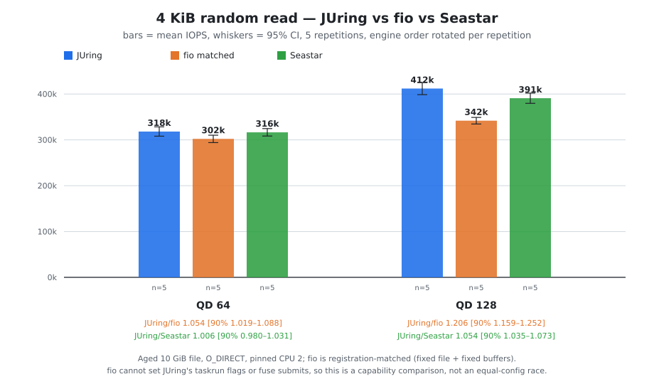
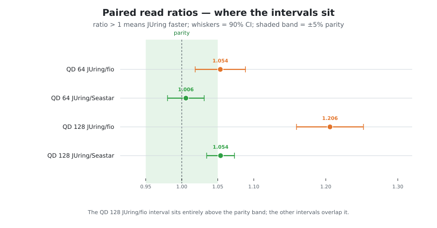
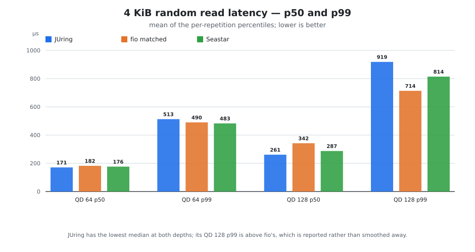
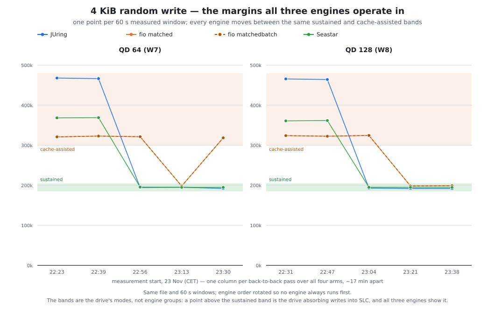
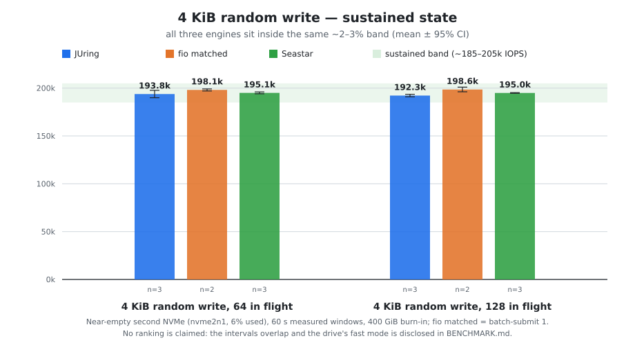
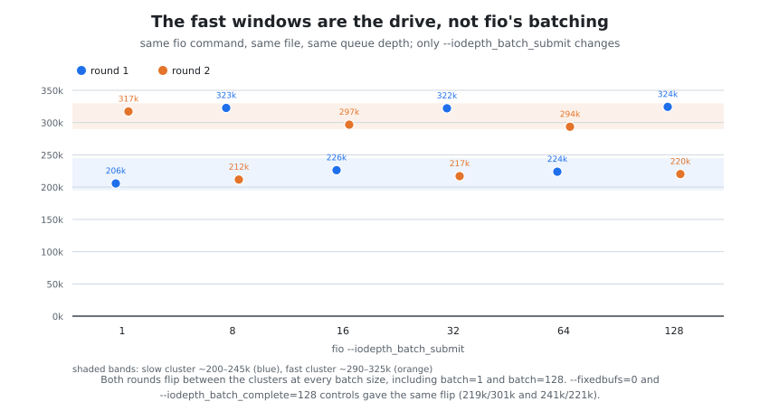

# JUring benchmarks

I didn't want to publish read and write numbers I couldn't explain. So every table in this file names the workload, the engine configuration and the number of repetitions, and for the harness tables the commands at the end regenerate the analysis from the raw output.

There are two kinds of evidence here. The main body is the harness under [`bench/`](bench/README.md): a fresh process per repetition, `fio` and Seastar as references, raw per-repetition JSON, and analyzers that rebuild every table. That is the evidence I would stand behind. The second kind is the older JMH microbenchmark suite, which I keep for single-thread overhead, virtual-thread behaviour and FFM downcall costs. Different harness, different statistics, so I keep those results separate.

Raw run directories are not committed — they're large and specific to this host. The release data archive and the caveats that come with the numbers are in [DATA-AVAILABILITY.md](DATA-AVAILABILITY.md).

## How I measured

One host, one consumer NVMe, one kernel. Everything in the main body ran on this machine:

- CPU: AMD Ryzen 9 3950X, 16 cores / 32 threads, one NUMA node, SMT pairs `c` and `c+16`. Governor `performance`, EPP `performance`, boost active (`1`).
- Memory: 62 GiB DDR4. THP active mode `madvise`; a dedicated 2 MiB `hugetlbfs` pool of `4,608 × 2 MiB = 9 GiB` at `/mnt/hugepages-juring`, used in the hugepage comparison below.
- Storage: GIGABYTE GP-ASM2NE6100TTTD 1 TB PCIe 4.0 NVMe, `/dev/nvme1n1p1`, ext4 mounted `rw,nosuid,nodev,relatime,seclabel`, no `discard`, `percentage_used = 3%`, `media_errors = 0`, SMART thermal throttle transitions `T1 = 0, T2 = 0`.
- OS and toolchain: Fedora Linux 44, kernel `7.0.12-201.fc44.x86_64`, OpenJDK `26.0.2` (`2026-07-21`), `fio 3.40`, `perf 7.2.11`, GCC `16.1.1`, Seastar `25.05.0-1392-g04b1c04d` (`04b1c04d`) built `--mode=release`.

Reads come from `/mnt/TestData/read_files/single_file_bench.bin`: 10 GiB (`10,737,418,240 B`), 72 extents, aged `mtime 2026-11-03`, opened read-only with `O_DIRECT`, never modified. Writes go to `nvme-data/write_files/single_file_bench_w.bin`, a dedicated 10 GiB preallocated file on the same partition.

Each repetition is a fresh process, or a fresh JVM for the JMH runs. Most tables use five repetitions; the `fio` configuration brackets, the `perf` runs and the group-commit runs use three. Engines are interleaved inside each repetition block, so a slow patch of host time hits all of them rather than just the last one. In the tables, `±` is always the two-sided 95% Student-t confidence interval of the mean (`df = n - 1`). Ratio intervals are two-sided 90% / 95%; the two-sided 90% lower bound is the same number as the one-sided 95% lower bound, and that is what I quote. No repetition is silently dropped or trimmed.

The full protocol, including the device-state rules and the statistics, is in [`docs/benchmark-methodology.md`](docs/benchmark-methodology.md). The decisions I made about what not to build — provided-buffer multishot, the I/O QoS scheduler — are in [`docs/design-notes.md`](docs/design-notes.md).

### Does the host setup change the answer?

I checked that before trusting anything else. Here is Seastar's `hugetlbfs` configuration against THP, paired, three repetitions per workload:

| Workload | Seastar, 2 MiB hugepages | Seastar, THP | huge / THP [95% CI] |
|---|---|---|---|
| 4 KiB random read, QD 64 | 317,986 IOPS | 319,074 IOPS | 0.9966 [0.9943, 0.9989] (−0.34%) |
| 4 KiB random read, QD 128 | 388,830 IOPS | 384,248 IOPS | 1.0122 [0.9475, 1.0768] (CI spans 1) |
| 1 MiB sequential read, QD 8 | 4,677 IOPS | 4,754 IOPS | 0.9836 [0.9105, 1.0567] (CI spans 1) |
| 1 MiB sequential read, QD 32 | 4,765 IOPS | 4,599 IOPS | 1.0389 [0.8721, 1.2057] (CI spans 1) |
| 4 KiB random read, 8 shards, QD 64 each | 467,341 IOPS | 461,800 IOPS | 1.0123 [0.9589, 1.0657] (CI spans 1) |

The hugepage choice doesn't change a conclusion. Four of the five intervals include parity, and the one that doesn't is −0.34%.

One caveat: `run-host-setup.sh` samples `/proc/meminfo` `HugePages_Free` before spawning `seastar_file_bench` and after it exits. Seastar maps an unlinked `file_desc::temporary` in `/mnt/hugepages-juring` with `MAP_SHARED | MAP_POPULATE` and throws if that fails (`SeaStarRef/src/core/memory.cc:2016-2025`), so the pages are freed when the process exits — before the second sample is taken (`hp0 = 4608 → hp1 = 4608`, with 15 warnings logged). The mapping did happen while Seastar ran; the second sample just can't prove it.

I also re-ran the 1 MiB sequential read workloads with `prlimit --memlock=unlimited:unlimited`, five paired repetitions. All 15 JUring runs used `io_buffer_mode = registered-fixed`, and all 15 `fio` runs used `fixedbufs = 1, registerfiles = 1`. Paired JUring / `fio-matched` means: QD 1 `1.0138 [0.9825, 1.0451]`, QD 8 `1.0108 [0.9582, 1.0635]`, QD 32 `1.0005 [0.9573, 1.0437]`. All three intervals include parity.

Finally, root `nvme smart-log` before, during and after confirmed `Thermal Management T1/T2 Trans Count = 0`, `critical_warning = 0`, `media_errors = 0`, and root `drop_caches` worked. The primary runs use `O_DIRECT`, so cold cache is the default state anyway. The representativeness run was 75 invocations, 75 `status=ok`, zero failures.

## Read throughput

On 4 KiB random reads, JUring matches the references at queue depth 1 and pulls ahead once the queue gets deep. The interesting part is where that comes from.

The three engines, as configured:

- JUring: `IORING_SETUP_SINGLE_ISSUER | IORING_SETUP_COOP_TASKRUN | IORING_SETUP_DEFER_TASKRUN`, registered file (`IOSQE_FIXED_FILE`), fixed buffers registered up front (`prepareReadFixed`), fused `submitAndWait`.
- `fio` with the io_uring engine, matched: `--ioengine=io_uring --direct=1 --registerfiles=1 --fixedbufs=1`.
- Seastar: `seastar_file_bench --reactor-backend=io_uring --smp 1 --cpuset 2 --memory 1G --lock-memory 0`, with its stock 200-entry ring, no `SINGLE_ISSUER`/`DEFER_TASKRUN`, and no registered files or fixed buffers. That is a bracket, not an equal opponent.

Ten seconds of warmup, thirty seconds measured, five repetitions, CPU 2:

| Workload | QD | Engine | n | IOPS mean ± 95% CI | MiB/s | p50 (µs) | p99 (µs) | CV% | Paired ratio vs fio [95% CI] | Paired ratio vs Seastar [95% CI] |
|---|---|---|---|---|---|---|---|---|---|---|
| 4 KiB random read | 1 | JUring | 5 | 10,969 ± 557 | 42.8 | 83.7 | 137.0 | 4.09 | 1.0234 [0.9248, 1.1220] | 0.9491 [0.9002, 0.9979] |
| 4 KiB random read | 1 | fio io_uring, matched | 5 | 10,748 ± 664 | 42.0 | 81.2 | 156.7 | 4.97 | — | — |
| 4 KiB random read | 1 | Seastar | 5 | 11,558 ± 31 | 45.1 | 81.9 | 98.9 | 0.21 | — | — |
| 4 KiB random read | 16 | JUring | 5 | 144,235 ± 4,248 | 563.4 | 100.9 | 222.8 | 2.37 | 1.0108 [0.9556, 1.0660] | 0.9908 [0.9612, 1.0204] |
| 4 KiB random read | 16 | fio io_uring, matched | 5 | 142,818 ± 4,994 | 557.9 | 98.6 | 225.1 | 2.82 | — | — |
| 4 KiB random read | 16 | Seastar | 5 | 145,575 ± 262 | 568.7 | 101.2 | 214.2 | 0.14 | — | — |
| 4 KiB random read | 64 | JUring | 5 | 327,371 ± 280 | 1,278.8 | 169.6 | 481.9 | 0.07 | 1.0771 [1.0477, 1.1064] | 1.0284 [1.0276, 1.0292] |
| 4 KiB random read | 64 | fio io_uring, matched | 5 | 304,064 ± 8,038 | 1,187.8 | 182.9 | 476.8 | 2.13 | — | — |
| 4 KiB random read | 64 | Seastar | 5 | 318,317 ± 437 | 1,243.4 | 176.8 | 471.4 | 0.11 | — | — |
| 4 KiB random read | 128 | JUring | 5 | 411,136 ± 19,180¹ | 1,606.0 | 262.6 | 916.9 | 3.76 | 1.2388 [1.1669, 1.3108]¹ | 1.0543 [1.0138, 1.0947] |
| 4 KiB random read | 128 | fio io_uring, matched | 5 | 332,133 ± 13,601¹ | 1,297.4 | 350.2 | 741.4 | 3.30 | — | — |
| 4 KiB random read | 128 | Seastar | 5 | 389,967 ± 9,419 | 1,523.3 | 290.8 | 794.2 | 1.95 | — | — |
| 1 MiB sequential read | 1 | JUring | 5 | 1,729 ± 54 | 1,728.8 | 546.6 | 888.7 | 2.53 | 1.0046 [0.9181, 1.0911] | 0.9916 [0.9049, 1.0783] |
| 1 MiB sequential read | 1 | fio io_uring, matched | 5 | 1,725 ± 108 | 1,725.5 | 504.2 | 1,044.5 | 5.03 | — | — |
| 1 MiB sequential read | 1 | Seastar | 5 | 1,748 ± 105 | 1,748.0 | 546.2 | 882.0 | 4.83 | — | — |
| 1 MiB sequential read, 8 MiB memlock | 8 | JUring (`arena`) | 5 | 4,656 ± 167 | 4,656.1 | 1,678.3 | 3,568.1 | 2.89 | 0.9788 [0.9428, 1.0147] | 0.9776 [0.9440, 1.0112] |
| 1 MiB sequential read, 8 MiB memlock | 8 | fio io_uring, regfile | 5 | 4,757 ± 17 | 4,757.2 | 1,577.8 | 2,388.8 | 0.29 | — | — |
| 1 MiB sequential read, 8 MiB memlock | 8 | Seastar | 5 | 4,763 ± 14 | 4,762.6 | 1,680.8 | 2,406.7 | 0.23 | — | — |
| 1 MiB sequential read, 8 MiB memlock | 32 | JUring (`arena`) | 5 | 4,720 ± 123 | 4,720.5 | 6,723.2 | 10,189.0 | 2.10 | 1.0161 [0.9891, 1.0431] | 1.0202 [0.9807, 1.0597] |
| 1 MiB sequential read, 8 MiB memlock | 32 | fio io_uring, regfile | 5 | 4,647 ± 151 | 4,646.9 | 6,586.4 | 14,155.8 | 2.61 | — | — |
| 1 MiB sequential read, 8 MiB memlock | 32 | Seastar | 5 | 4,632 ± 261 | 4,631.9 | 6,694.2 | 14,553.6 | 4.53 | — | — |

¹ At QD 128, one JUring repetition (`386,629` IOPS) and one `fio-matched` repetition (`314,883` IOPS) were slow-state outliers under the `< 0.92 × max` rule. The fast-subset means (`n = 4`) are `417,263 ± 13,110` against `336,445 ± 9,547`, and the paired fast-subset ratio (`n = 3`) is `1.2542 [1.2139, 1.2946]`.

### Running it twice, with the order rotated

The table above ran the engines in a fixed order and used `fio`'s default submit batching, which is a fair thing to be suspicious of. So for the 0.1.0 release I re-ran the two deep-queue workloads with the engine order rotated per repetition, added a second `fio` reference whose batching matches how JUring submits, and used the release-candidate code (`5202e88`). The command was `REPS=5 bench/m1/run-claims-0.1.sh`.

Each `fio` variant writes to its own sub-session, `bench/results/claims-0.1-20261117/read-matrix-{matched,matchedbatch}`, with aggregates generated next to it by `bench/m1/analyze_read_write.py`. Same host, `performance` governor, five repetitions, 10 s warmup + 30 s measured. Preflight `loadavg(1m)` was 0.74 for the matched run and 0.29 for the batching-matched run.

Matched reference:

| Workload | QD | Engine | n | IOPS mean ± 95% CI | p50 (µs) | p99 (µs) | CV% | Paired vs fio [95% CI] | Paired vs Seastar [95% CI] |
|---|---|---|---|---|---|---|---|---|---|
| 4 KiB random read | 64 | JUring | 5 | 323,876 ± 8,104 | 170.1 | 492.6 | 2.0 | 1.0655 [1.0167, 1.1143] | 1.0293 [0.9899, 1.0686] |
| 4 KiB random read | 64 | fio io_uring, matched | 5 | 304,160 ± 9,750 | 182.5 | 478.0 | 2.6 | — | — |
| 4 KiB random read | 64 | Seastar | 5 | 314,786 ± 7,404 | 177.8 | 480.1 | 1.9 | — | — |
| 4 KiB random read | 128 | JUring | 5 | 406,966 ± 19,948² | 263.6 | 931.9 | 3.9 | 1.2183 [1.1596, 1.2771]² | 1.0622 [1.0385, 1.0859]² |
| 4 KiB random read | 128 | fio io_uring, matched | 5 | 334,074 ± 8,122 | 349.4 | 721.7 | 2.0 | — | — |
| 4 KiB random read | 128 | Seastar | 5 | 383,200 ± 19,155 | 292.8 | 834.8 | 4.0 | — | — |

Batching-matched reference:

| Workload | QD | Engine | n | IOPS mean ± 95% CI | p50 (µs) | p99 (µs) | CV% | Paired vs fio [95% CI] | Paired vs Seastar [95% CI] |
|---|---|---|---|---|---|---|---|---|---|
| 4 KiB random read | 64 | JUring | 5 | 323,753 ± 8,575 | 170.3 | 491.8 | 2.1 | 1.0693 [1.0209, 1.1178] | 1.0501 [0.9787, 1.1215] |
| 4 KiB random read | 64 | fio io_uring, matchedbatch | 5 | 302,930 ± 8,195 | 183.3 | 480.9 | 2.2 | — | — |
| 4 KiB random read | 64 | Seastar | 5 | 308,844 ± 16,057 | 178.2 | 507.9 | 4.2 | — | — |
| 4 KiB random read | 128 | JUring | 5 | 410,833 ± 14,052 | 262.2 | 914.4 | 2.8 | 1.2306 [1.1694, 1.2918] | 1.0625 [1.0106, 1.1144] |
| 4 KiB random read | 128 | fio io_uring, matchedbatch | 5 | 334,025 ± 8,714 | 350.2 | 720.1 | 2.1 | — | — |
| 4 KiB random read | 128 | Seastar | 5 | 386,854 ± 10,835 | 291.5 | 806.5 | 2.3 | — | — |

² In the matched QD 128 run, one JUring repetition (`385,000` IOPS) and one Seastar repetition were flagged slow by the `< 0.92 × max` rule, so the analyzer also reports the fast subset: JUring / fio `1.2275 [1.1696, 1.2854]` (`n = 4`) and JUring / Seastar `1.0594 [1.0349, 1.0839]` (`n = 4`). The batching-matched QD 128 configurations were all fast.

That doubles as a regression check. JUring reproduces the original table within about 1% in both runs: QD 64 `323,876` / `323,753` (−1.1% against `327,371`), QD 128 `406,966` / `410,833` (−1.0% / −0.1% against `411,136`); `fio-matched` `304,160` against `304,064`, `matchedbatch` `302,930` (QD 64) / `334,025` (QD 128), Seastar `314,786` / `308,844` (QD 64) and `383,200` / `386,854` (QD 128). The paired JUring / fio ratios reproduce as `1.0655–1.0693` (QD 64, original `1.0771`) and `1.2183–1.2306` (QD 128, original `1.2388`); JUring / Seastar as `1.0293–1.0501` and `1.0622–1.0625`.

The release-candidate hardening batch changed no read-path code, and the per-op cost is unchanged: `11,438` cycles/op and `0.327` syscalls/op against the original `11,335` / `0.330`. So the small absolute deltas are host-state noise common to all engines, not a regression. The batching-matched reference is not faster than the matched one, which means the historical `fio` reference was already representative for batching. What is left is the capability difference: JUring's ring flags and fused submit. So I treat these as capability comparisons, not as an apples-to-apples win.

### Re-running the claims, 2026-11-23

I re-ran the two deep-queue read cells on 2026-11-23 with the same protocol as the rotated run: three engines, five repetitions, 10 s warmup + 30 s measured, a fresh process per repetition, engine order rotated per repetition, every engine pinned to CPU 2, the same host, the same 10 GiB `O_DIRECT` file. The command was `WARMUP=10 DURATION=30 REPS=5 QDS="64 128" ENGINES="juring seastar fio-io_uring" FIO_VARIANT=matched ROTATE_ENGINES=1 bench/m1/run-read-matrix.sh` with `M1_RESULTS=bench/results/rerun-2026-11-23/read`; Seastar is the same-file runner. All 30 cell runs returned `status=ok`.

| Workload | QD | Engine | n | IOPS mean ± 95% CI | p50 (µs) | p99 (µs) | CV% | Paired vs fio | Paired vs Seastar |
|---|---|---|---|---|---|---|---|---|---|
| 4 KiB random read | 64 | JUring | 5 | 318,172 ± 10,205 | 170.6 | 512.8 | 2.6 | 1.0536 [90% 1.0187, 1.0885] | 1.0057 [90% 0.9803, 1.0312] |
| 4 KiB random read | 64 | fio io_uring, matched | 5 | 302,107 ± 8,082 | 182.1 | 489.9 | 2.2 | — | — |
| 4 KiB random read | 64 | Seastar | 5 | 316,420 ± 8,132 | 176.4 | 482.8 | 2.1 | — | — |
| 4 KiB random read | 128 | JUring | 5 | 411,929 ± 13,306 | 260.9 | 918.5 | 2.6 | 1.2059 [90% 1.1594, 1.2523] | 1.0539 [90% 1.0347, 1.0732] |
| 4 KiB random read | 128 | fio io_uring, matched | 5 | 341,774 ± 7,242 | 342.0 | 713.5 | 1.7 | — | — |
| 4 KiB random read | 128 | Seastar | 5 | 390,886 ± 11,143 | 287.2 | 814.2 | 2.3 | — | — |



*Mean IOPS with 95% CIs from the rerun, five repetitions each. fio is the
registration-matched reference; Seastar is the same-file bracket.*

The rerun reproduces the published picture: JUring is `−1.8%` at QD 64 and `+1.2%` at QD 128 against the 0.1.0 numbers, `fio-matched` `−0.7%` / `+2.3%`, Seastar `+0.5%` / `+2.0%`. The paired ratios are `1.0536` against fio and `1.0057` against Seastar at QD 64, and `1.2059` / `1.0539` at QD 128. Read honestly, that is "about 5% ahead of fio, level with Seastar" at QD 64, and "about 21% ahead of fio, about 5% ahead of Seastar" at QD 128. The one-sided 95% lower bound clears the 1.05 bar against fio at QD 128 (`1.1594`) but not against fio at QD 64 (`1.0187`) or against Seastar at either depth (`0.9803`, `1.0347`); the tail difference at QD 128 is real (p99 `918.5` µs against `713.5` µs for fio) and is reported, not smoothed away. QD 1/16, the 1 MiB sequential rows, streams, shard scale-out and the group-commit rows were not re-run in this session; their numbers in this document remain the 0.1.0 measurements.



*Paired ratios put the intervals next to the ±5% parity band. The QD 128 JUring/fio interval is entirely above the band; the others overlap it, which is why the text claims a clear lead over fio only at QD 128.*



*Mean of the per-repetition p50/p99 from the rerun. JUring has the lowest median at both depths; its QD 128 p99 (`919` µs) is higher than fio's (`714` µs).*

### How much does the fio configuration matter?

If the `fio` reference is sensitive to configuration, a single unmatched reference is a weak opponent. So I swept it at the two deep queue depths. Bracket variants use three repetitions; the matched reference is the five-repetition row from the main table.

| Workload | QD | fio configuration | n | IOPS mean ± 95% CI | p50 (µs) | p99 (µs) | CV% |
|---|---|---|---|---|---|---|---|
| 4 KiB random read | 64 | matched (`--registerfiles=1 --fixedbufs=1`) | 5 | 304,064 ± 8,038 | 182.9 | 476.8 | 2.1 |
| 4 KiB random read | 64 | batch32 (`--iodepth_batch_submit=32`) | 3 | 296,990 ± 327 | 189.4 | 458.1 | 0.0 |
| 4 KiB random read | 64 | default (unregistered, `batch_submit=1`) | 3 | 290,440 ± 20,620 | 192.2 | 478.5 | 2.9 |
| 4 KiB random read | 64 | batch16 (`--iodepth_batch_submit=16`) | 3 | 288,413 ± 17,422 | 191.5 | 500.4 | 2.4 |
| 4 KiB random read | 64 | batch8 (`--iodepth_batch_submit=8`) | 3 | 282,847 ± 34,161 | 192.9 | 527.0 | 4.9 |
| 4 KiB random read | 64 | libaio | 3 | 277,559 ± 4,704 | 207.9 | 448.5 | 0.7 |
| 4 KiB random read | 64 | sqpoll (`--sqthread_poll=1`, negative bracket) | 3 | 10,766 ± 30 | 5,996.5 | 8,978.4 | 0.1 |
| 4 KiB random read | 128 | matched (`--registerfiles=1 --fixedbufs=1`) | 5 | 332,133 ± 13,601 | 350.2 | 741.4 | 3.3 |
| 4 KiB random read | 128 | default | 3 | 296,536 ± 21,157 | 403.5 | 708.6 | 2.9 |
| 4 KiB random read | 128 | libaio | 3 | 271,047 ± 6,121 | 441.7 | 741.4 | 0.9 |

At QD 64 the registration-matched configuration was the fastest `fio` variant (`304,064 ± 8,038` IOPS). Turning on `--sqthread_poll=1` dropped it to `10,766 ± 30` IOPS, which is why I treat that as a negative bracket rather than a contender. At QD 128 the matched configuration was again fastest (`332,133 ± 13,601`), ahead of default (`296,536 ± 21,157`) and libaio (`271,047 ± 6,121`). Whatever advantage JUring shows above, it is not because I made the `fio` baseline deliberately weak.

## CPU, syscalls and latency

Throughput is the easy number. The interesting question is what it costs.

`perf stat` was attached for a 30 s steady-state window inside a 40 s measured phase, three repetitions per row. Cycles are user plus kernel.

| Workload | QD | Engine | n | Cycles / op (`u+k`) ± 95% CI | Instructions / op | Syscalls / op | Context switches / op |
|---|---|---|---|---|---|---|---|
| 4 KiB random read | 1 | JUring | 3 | 27,254 ± 188 | 16,381 | 0.991 | 0.9910 |
| 4 KiB random read | 1 | fio io_uring, perf-matched | 3 | 32,424 ± 229 | 19,781 | 2.009 | 0.9983 |
| 4 KiB random read | 1 | Seastar (busy-poll reactor) | 3 | 383,329 ± 170 | 618,289 | 1.350 | 0.0010 |
| 4 KiB random read | 64 | JUring | 3 | 11,335 ± 121 | 7,542 | 0.330 | 0.0437 |
| 4 KiB random read | 64 | fio io_uring, perf-matched | 3 | 15,227 ± 604 | 10,372 | 1.012 | 0.0010 |
| 4 KiB random read | 64 | Seastar | 3 | 13,859 ± 158 | 9,583 | 0.186 | 0.0000 |

At saturation — 4 KiB random read, QD 64 — JUring uses 25.6% fewer CPU cycles per operation than matched `fio` (`0.7445 [0.7225, 0.7665]`). I had set myself a 15% ceiling on the cycles, and this run came in well under it. The same row shows `0.330` syscalls per I/O for JUring against `1.012` for `fio`. Fused submit and fixed buffers are doing what they were built to do.

Seastar's busy-poll reactor looks completely different. At QD 1 it burns `383,329 ± 170` cycles per operation and makes `1.350` syscalls, with almost no context switches. That is the reactor model, not a mistake: it trades CPU for latency. Read those rows in that light.

### Tail latency

Averages hide the part that hurts, so I measured the tail too. JUring and Seastar timestamp before submission and at completion (uniform Algorithm R reservoirs); `fio` reports `clat`. Ten seconds of warmup, 120 seconds measured, five repetitions:

| Workload | QD | Engine | n | IOPS mean ± 95% CI | p50 (µs) | p95 (µs) | p99 (µs) | p999 (µs) | max (µs) | Paired JUring / fio p99 ratio [95% CI] |
|---|---|---|---|---|---|---|---|---|---|---|
| 4 KiB random read | 1 | JUring | 5 | 11,042 ± 125 | 83.6 | 99.2 | 107.8 | 630.9 | 7,084.1 | 1.0931 [0.9349, 1.2513] (well inside 2× of fio) |
| 4 KiB random read | 1 | fio io_uring, matched | 5 | 11,133 ± 19 | 81.4 | 96.8 | 98.6 | 590.6 | 4,250.3 | — |
| 4 KiB random read | 1 | Seastar | 5 | 11,533 ± 77 | 81.9 | 97.6 | 98.9 | 140.5 | 4,681.5 | — |
| 4 KiB random read | 64 | JUring | 5 | 327,488 ± 2,141 | 169.5 | 367.1 | 481.5 | 660.5 | 5,014.5 | 1.0064 [0.9670, 1.0458] (well inside 1.10× of fio) |
| 4 KiB random read | 64 | fio io_uring, matched | 5 | 303,410 ± 3,322 | 182.9 | 361.7 | 478.8 | 985.5 | 8,022.7 | — |
| 4 KiB random read | 64 | Seastar | 5 | 308,547 ± 11,877 | 177.2 | 371.8 | 504.9 | 1,881.2 | 16,016.8 | — |

At QD 64 the p99 is `481.5 µs` for JUring, `478.8 µs` for `fio` and `504.9 µs` for Seastar, and the paired JUring / fio p99 ratio is `1.0064 [0.9670, 1.0458]`. Beyond p99 is where the async path pulls away: p99.9 is `660.5 µs` against `985.5 µs` and `1,881.2 µs`, and the max is `5,014.5 µs` against `8,022.7 µs` and `16,016.8 µs`. At QD 1 the p99 ratio is `1.0931 [0.9349, 1.2513]`, inside the 2× bar, but that interval is wide enough that I wouldn't read a win into it.

## Streams

A ring is not much use if reading a file through it is slower than a buffered `InputStream`. So I built `JuringInputStream` and `JuringOutputStream` and compared them to Seastar's `fstream`. Five repetitions, 10 s warmup + 60 s measured, 300 s rests between runs. The session was 60 invocations, all `status=ok`.

| Workload | Buffer | Prefetch / write-behind | JUring MiB/s ± 95% CI | Seastar `fstream` MiB/s ± 95% CI | Point ratio | Paired ratio [90% / 95% CI] | Result |
|---|---|---|---|---|---|---|---|
| Sequential stream read | 128 KiB | `readAhead = 8` | 2,284.6 ± 76.2 | 2,327.5 ± 72.3 | 0.9816 | 0.9816 [90% 0.966..0.998; 95% 0.961..1.003] | within 2% of Seastar (strict lower bound 0.966) |
| Sequential stream read | 1 MiB | `readAhead = 4` | 4,662.8 ± 287.6 | 4,724.3 ± 131.3 | 0.9865 | 0.9865 [90% 0.960..1.013; 95% 0.952..1.021] | within 2% of Seastar (strict lower bound 0.960) |
| Sequential stream write | 128 KiB | `writeBehind = 8` | 610.0 ± 402.8 | 438.6 ± 359.8 | 1.3908 | Position-matched: `1.232×` fast / `0.984×` slow (pooled `1.250×`) | point estimate; drive state confounded¹ |
| Sequential stream write | 1 MiB | `writeBehind = 4` | 569.5 ± 386.7 | 355.7 ± 300.1 | 1.6011 | Position-matched: `1.269×` fast / `1.384×` slow (pooled `1.142×`) | point estimate; drive state confounded¹ |

¹ (a) On writes, the first engine after a 300 s rest ran in the drive's fast state (`~600–850 MiB/s`) and the second ran in the slow state (`~107–572 MiB/s`), so position-matched strata are reported rather than paired-repetition speedups. (b) Seastar ran `durable=true` (2 `fdatasync` per pass at `flush()` and `close()`) while JUring ran `syncOnClose=false` (0 per pass). The group-commit work added explicit `DurabilityMode` values (`WRITEBACK`, `FDATASYNC`, `FSYNC`, `DSYNC`) and verified matched durability accounting (`MiB/sync ≈ 3.99` for both engines).

Reads are parity: `0.9816` and `0.9865` of Seastar's throughput, with strict lower bounds of `0.966` and `0.960` against a `0.85` bar. Writes look like a point-estimate win (`1.3908` and `1.6011`), but the state confound matters — the first engine after a 300 s rest ran fast and the second ran slow, so I quote position-matched strata (`1.232×` fast / `0.984×` slow and `1.269×` / `1.384×`). Durability wasn't matched in that run either: Seastar synced and JUring didn't. I treat those write rows as point estimates, not a ranking. Group commit is where durability actually gets measured.

## Group commit

Batching writes is only worth something if it doesn't weaken durability. `GroupCommit` shares one `fdatasync` across a batch and still makes every write durable; the table below is the evidence for the one-sync-per-group part.

4 KiB `O_DIRECT` writes with `DurabilityMode.FDATASYNC`: three repetitions of a 5 s warmup and a 15 s measured window, one fresh process per arm, then a fresh process reopens the file and verifies it byte by byte. All three reps are kept; nothing is trimmed.

| Batch size (`N`) | Groups/s | Writes/s | Explicit `fdatasync`s/s | `fsyncs_per_group` | Throughput (MiB/s, mean ± 95% CI) | Fresh-process restart check |
|---|---|---|---|---|---|---|
| 1 | 1,521.5 | 1,522 | 1,521.5 | 1.000000 | 5.9 ± 4.4 | pass |
| 8 | 2,011.1 | 16,089 | 2,011.1 | 1.000000 | 62.8 ± 50.7 | pass |
| 32 | 2,350.0 | 75,201 | 2,350.0 | 1.000000 | 293.8 ± 16.3 | pass |
| 128 | 1,441.4 | 184,497 | 1,441.4 | 1.000000 | 720.7 ± 20.2 | pass |

`fsyncs_per_group` stays at exactly `1.000000` all the way from batch 1 to batch 128. That matters: the throughput climb from `5.9 MiB/s` at batch 1 to `720.7 MiB/s` at batch 128 comes from doing fewer syncs, not from dropping durability. Every configuration also passes the fresh-process restart check, so the bytes really are on the file when the run ends.

The sync *rate* barely moves (`1,521.5` to `1,441.4` per second); what changes is how much each sync covers, from `4 KiB` to `512 KiB`. Read the batch 1 and batch 8 intervals before quoting a multiplier, though: those are the noisiest cells (`CV` 29.7 % and 32.4 %, all three reps kept), because a write that pays its own sync is bounded by sync latency rather than throughput. The batch 128 cell is the measurement I would stand behind (CV 1.1 %).

## Multi-ring scale-out

One ring on one thread has a ceiling. The question is whether sharding work across rings scales cleanly, and whether the per-ring metrics cost anything when you turn them on.

4 KiB random read, QD 64 per shard, one to eight shards, five repetitions, 10 s warmup + 30 s measured, 300 s rests. For one to four shards, worker threads are pinned to CPUs `1..N`; eight shards are confined to the eight data-NVMe `blk-mq` hardware-queue CPUs `1,2,4,6,8,10,12,14` (`mq/0..7`). The session was 60 invocations, all `status=ok`.

| Shards | JUring group IOPS [95% CI] | `fio numjobs=N` IOPS [95% CI] | `seastar --smp N` IOPS [95% CI] | Paired JUring / fio mean (lower bound) | Paired Seastar / JUring mean (lower bound) | JUring per-shard `min/mean` (lower bound) |
|---|---|---|---|---|---|---|
| 1 | 320,760 [313,221, 328,300] | 323,284 [317,252, 329,315] | 317,330 [304,399, 330,260] | 0.992 (lower bound 0.959 ≥ 0.85) | 0.990 (lower bound 0.936) | — |
| 2 | 391,855 [351,094, 432,617] | 403,669 [388,783, 418,556] | 427,332 [426,113, 428,551] | 0.973 (lower bound 0.859 ≥ 0.85) | 1.102 (lower bound 0.976) | — |
| 4 | 465,936 [455,790, 476,083] | 463,263 [446,410, 480,117] | 462,364 [446,966, 477,762] | 1.007 (lower bound 0.961 ≥ 0.85) | 0.993 (lower bound 0.948) | — |
| 8 | 473,126 [464,598, 481,654] | 459,125 [441,418, 476,832] | 466,460 [458,249, 474,672] | 1.032 (lower bound 0.987 ≥ 0.85) | 0.986 (lower bound 0.959 ≥ 0.90) | 0.963 (lower bound 0.947 ≥ 0.85) |

Seastar / JUring ratios are paired per-repetition means; the Seastar pass criterion was only defined at eight shards.

Eight shards reached `473,126` IOPS against `459,125` for `fio` with eight jobs and `466,460` for Seastar with eight reactors. The per-shard `min/mean` at eight shards was `0.963` with a lower bound of `0.947`, so the shards stayed balanced. I had five criteria: throughput against `fio` at least 0.85; same-shard-count scaling efficiency and p99 reporting; per-shard `min/mean` at eight shards at least 0.85; Seastar / JUring at eight shards at least 0.90; and, for the per-ring metrics, queue depth `62–65` with runtime completion p99 and zero failed / cancelled / timedOut operations across all 75 ring rows. All five held.

### What instrumentation costs

Instrumentation has to pay for itself, or people turn it off. I compared the metrics build — `RingMetrics` plus `LatencyHistogram` with `latencySampleEvery = 1` and 1 Hz `ring_series` — against the uninstrumented baseline (commit `6cc1a75`) in a paired A/B. Five repetitions, 4 KiB random read at QD 64:

| Configuration | Paired instrumented / uninstrumented | 95% lower bound |
|---|---|---|
| 1 shard | 1.0190 | 0.991 |
| 8 shards | 1.0110 | 0.973 |
| Threaded mode, 1 worker | 1.0070 | 0.972 |

The point estimates are slightly above 1, but the 95% lower bounds are below it. The honest reading is no measurable throughput cost at this power, not a speedup claim. That is under the 1% instrumentation cost I said I'd accept.

## What a single thread can do

I measured these before the stream and shard work, as a baseline: what does one thread get from JUring compared with a synchronous `FileChannel`, and what does the ring cost when there is no I/O at all?

These tables come from the earlier JMH suite under `src/test/java/bench/suite/`, on OpenJDK `25.0.3`. In this section `±` is JMH's 99.9% confidence interval across JMH iterations, not the multi-process Student-t interval used above. Do not compare these ops/invocation numbers directly against the `fio` time-window IOPS, and do not use the multi-thread write rows for ranking — several of those write intervals are `30k–397k` ops/s wide because the NVMe SLC cache exhausted during the run. For comparisons against `fio` and Seastar, always use the tables above.

| Target | Concurrency / QD | Throughput (ops/s) | Bandwidth | Syscalls / op (`raw_syscalls:sys_enter`) | User CPU (`cycles:u/op`) | Kernel CPU (`cycles:k/op`) | Heap alloc |
|---|---|---|---|---|---|---|---|
| `NopBenchmark.juringNop` | 1T (QD=64, ring memory only) | 11,590,187.4 ± 53,591.1 | — | 0.0313 (32.0 ops/call) | 52.7 | 351.1 | 0.006 B/op |
| `FileChannel.read` | 1T (QD=1, synchronous `pread64`) | 11,101.7 ± 979.7 | 43.4 ± 3.8 MB/s | 1.0023 | 1370.2 | 24409.8 | 0.209 B/op |
| `JUring.read` (QD=1) | 1T (QD=1, unbatched `O_DIRECT`) | 11,479.8 ± 34.1 | 44.8 ± 0.1 MB/s | 1.0046 | 3990.5 | 25004.6 | 6.451 B/op |
| `JUring.read` (QD=64) | 1T (QD=64, batched pipeline) | 330,195.7 ± 361.3 | 1,289.8 ± 1.4 MB/s | 0.4569 | 283.6 | 10541.4 | 0.227 B/op |
| `FileChannel.write` | 1T (QD=1, synchronous `pwrite64`) | 72,470.8 ± 1,044.1 | 283.1 ± 4.1 MB/s | 1.0004 | 901.3 | 25023.8 | 0.050 B/op |
| `JUring.write` (QD=1) | 1T (QD=1, unbatched `O_DIRECT`) | 72,409.4 ± 1,577.1 | 282.8 ± 6.2 MB/s | 1.0022 | 724.5 | 26086.7 | 1.521 B/op |
| `JUring.write` (QD=64) | 1T (QD=64, batched pipeline) | 191,163.1 ± 17,715.3 | 746.7 ± 69.2 MB/s | 0.1445 | 286.3 | 11941.4 | 0.574 B/op |

After initialization, JUring's submission and completion hot path — submitting SQEs, reaping CQEs through `ResultConsumer`, and reusing fixed buffers — allocates 0 bytes on the calling thread. That is verified in [`ZeroAllocationHotPathTest.java`](src/test/java/com/davidvlijmincx/lio/api/ZeroAllocationHotPathTest.java), and in the test suites for `JuringFile`, `JUringBlocking`, `RingMetrics` / `LatencyHistogram` and `GroupCommit`.

### Queue depth sweep

Because `FileChannel` operations are synchronous, a single thread can only have one I/O in flight. JUring drives the hardware queue asynchronously from one thread:

| Queue depth | JUring (1 thread) throughput | JUring bandwidth | `FileChannel` (1 thread) throughput | `FileChannel` bandwidth | Speedup (JUring vs `FileChannel`) |
|---|---|---|---|---|---|
| QD = 1 | 11,492.2 ± 49.6 | 44.9 ± 0.2 MB/s | 11,431.7 ± 48.2 | 44.7 ± 0.2 MB/s | 1.0x |
| QD = 16 | 148,011.3 ± 190.3 | 578.2 ± 0.7 MB/s | 11,447.1 ± 34.3 | 44.7 ± 0.1 MB/s | 12.9x |
| QD = 32 | 236,162.3 ± 423.9 | 922.5 ± 1.7 MB/s | 11,174.3 ± 1,316.8 | 43.6 ± 5.1 MB/s | 21.1x |
| QD = 64 | 330,089.1 ± 748.0 | 1,289.4 ± 2.9 MB/s | 11,437.3 ± 21.9 | 44.7 ± 0.1 MB/s | 28.9x |

The shape is the point. One thread at QD 64 moves 28.9× the I/O of one thread doing synchronous reads, which is the whole reason to use a ring from a single thread at all.

## Virtual threads

Virtual threads and `io_uring` should be a good match. A virtual thread that blocks in `pread64` pins its carrier; a virtual thread that parks while a poller drives the ring does not. The numbers below are from the older JMH run though, and I want to be precise about what they do and don't prove.

This whole section is historical evidence from before the 0.1.0 release. I did not rerun it for 0.1.0: the benchmark harness does not record a committed CLI/JVM flag string, several confidence intervals (JMH's 99.9% interval, not the multi-process one above) overlap, and the "equal total platform thread budget" framing measures thread efficiency rather than a per-operation engine difference. I keep it for transparency and context, not as a 0.1.0 ranking. The defensible results are parity at Loom defaults (uncapped carrier pool, below) and "same device throughput with 2–4 poller threads instead of hundreds of carriers" under a fixed budget.

The data predates the 0.1.0 `JUringBlocking` capacity model and is unchanged: the 1,000-virtual-thread JMH runs were not rerun for 0.1.0, and I make no new performance claim here. The scale evidence for the blocking facade is the committed scale test [`JUringBlockingScaleTest`](src/test/java/com/davidvlijmincx/lio/api/JUringBlockingScaleTest.java) — the normal suite runs it with 10,000 virtual threads, and a 1,000,000-thread run is opt-in via [`bench/blocking/run-scale.sh`](bench/blocking/run-scale.sh). That test asserts correctness and bounded resources (every call completes, the admission path is exercised, all records are released) at the configured scale; it is not a throughput benchmark. The capacity model, sizing recipe and memory math are in [`docs/vt-scale.md`](docs/vt-scale.md).

When `FileChannel` blocks a virtual thread in kernel I/O, the virtual thread stays pinned or mounted to its carrier thread, so the ForkJoinPool scheduler compensates by spawning up to `maxPoolSize` (default 256) carrier threads. `JUringBlocking` unmounts the virtual thread with `LockSupport.park()` while its `IoShard`-backed poller threads drive `io_uring`.

### Same platform-thread budget

1,000 virtual threads, increasing the allowed platform threads:

| Platform thread budget | Engine | Thread breakdown | Throughput (ops/s) | Bandwidth | Speedup |
|---|---|---|---|---|---|
| 1 thread (min) | `FileChannel` | 1 carrier | 11,433.8 ± 31.5 | 44.7 ± 0.1 MB/s | baseline |
| 1–2 threads (min) | `JUringBlocking` | 1 carrier + 1 poller (2T) | 399,108.7 ± 89,551.6 | 1,559.0 ± 349.8 MB/s | 34.91x |
| 4 threads | `FileChannel` | 4 carriers | 43,080.4 ± 220.6 | 168.3 ± 0.9 MB/s | baseline |
| 4 threads | `JUringBlocking` | 2 carriers + 2 pollers | 452,192.8 ± 1,262.9 | 1,766.4 ± 4.9 MB/s | 10.50x |
| 8 threads | `FileChannel` | 8 carriers | 73,003.5 ± 23,547.5 | 285.2 ± 92.0 MB/s | baseline |
| 8 threads | `JUringBlocking` | 4 carriers + 4 pollers | 389,340.6 ± 158,626.3 | 1,520.9 ± 619.6 MB/s | 5.33x |
| 16 threads | `FileChannel` | 16 carriers | 137,326.1 ± 32,534.5 | 536.4 ± 127.1 MB/s | baseline |
| 16 threads | `JUringBlocking` | 8 carriers + 8 pollers | 443,592.3 ± 40,401.8 | 1,732.8 ± 157.8 MB/s | 3.23x |

A note on buffer registration and interval width. In `VirtualThreadBenchmark.java`, `JUringVirtualThreadState` uses `ring.read(fileIdx, buf, fileOffset)` — a registered file descriptor with a caller-allocated aligned `MemorySegment`, not fixed buffers registered up front — so buffer allocation is symmetric with `FileChannel`. The 1–2T (`399,109 ± 89,552`), 8T (`389,341 ± 158,626`) and 16T (`443,592 ± 40,402`) intervals overlap the 4T mean (`452,193 ± 1,263`) because the NVMe is already near saturation at 2–4 pollers.

### Same carrier pool versus Loom defaults

| Configuration | Virtual threads | Engine | Throughput (ops/s) | Bandwidth |
|---|---|---|---|---|
| Equal carriers (4 carrier threads) | 1,000 | `FileChannel` | 39,917.4 ± 10,251.7 | 155.9 ± 40.0 MB/s |
| Equal carriers (4 carrier threads) | 1,000 | `JUringBlocking` | 449,448.2 ± 12,379.6 | 1,755.7 ± 48.4 MB/s |
| Default Loom pool (`maxPoolSize=256`, 250 VTs) | 250 | `FileChannel` | 445,255.8 ± 502.2 | 1,739.3 ± 2.0 MB/s |
| Default Loom pool (`maxPoolSize=256`, 250 VTs) | 250 | `JUringBlocking` | 441,046.7 ± 3,085.8 | 1,722.8 ± 12.1 MB/s |
| Expanded Loom pool (`maxPoolSize=1024`) | 1,000 | `FileChannel` | 379,776.6 ± 21,294.0 | 1,483.5 ± 83.2 MB/s |
| Expanded Loom pool (`maxPoolSize=1024`) | 1,000 | `JUringBlocking` | 425,417.5 ± 86,203.3 | 1,661.8 ± 336.7 MB/s |

When `FileChannel` is allowed to spawn hundreds of OS carrier threads (`maxPoolSize = 256` or `1024`), the kernel block layer gets high concurrency from those threads and saturates the NVMe — at the cost of hundreds of OS threads. When platform threads are budgeted (`4` carriers), `JUringBlocking` reaches the same device ceiling with `2–4` poller threads.

## The write path I could not measure fairly

I tried to measure write parity. I could not do it honestly, so I'm not publishing a ranking.

The first attempt was the full write matrix. I ran 4 KiB random writes at QD 1/16/64/128 and 1 MiB sequential writes at QD 1/8/32: 130 completed runs over 8 h 47 m. Each configuration got a device preconditioning pass (a 30 GiB target — 3× the 10 GiB write file — applied in 4 GiB chunks, so a burst stops on a chunk boundary at 8 × 4 GiB = 32 GiB = 34.36 GB) and a 600 s rest, with 300 s rests between repetitions and a 1 s device IOPS series. 36 of the 130 runs hit an in-run SLC-burst to steady-state write cliff (within-run burst/steady ratios `0.14×` to `3.85×`, for example `195k → 59k` IOPS). That left 21 of 34 configurations unstable, 17 of them with `CV > 10%`, and an unstable configuration gets no ranking from me.

At 4 KiB random write QD 64 with five repetitions, JUring was stable (`188,704 ± 1,983` IOPS, `CV = 0.8%`), while `fio/matched` (`158,570 ± 50,427`, `CV = 25.6%`), `fio/matchedbatch` (`170,543 ± 42,826`, `CV = 20.2%`) and Seastar (`167,073 ± 43,672`, `CV = 21.1%`) randomly sampled post-cliff states across repetitions.

The second attempt was a state-controlled protocol: seven passes, 42 runs over 2 h 22 m. The idea was to run JUring, `fio/matched` and `fio/matchedbatch` back-to-back inside a single preconditioned pass, so all three engines see the same device state, and compare them only when a pass is homogeneous (`max/min ≤ 1.25` per configuration).

The first pilot used a 600 s rest after preconditioning and no rest between runs. It failed: at 4 KiB QD 64 the `max/min` was `2.0921` (`191,497 / 167,671 / 91,534` IOPS). A 600 s rest partially rebuilds the SLC burst capacity, which then exhausts mid-pass and makes the last engine look terrible.

The second pilot dropped the post-preconditioning rest and the between-run rest. It passed: at 4 KiB QD 64 the three engines measured `188,070 / 197,148 / 196,440` IOPS (`max/min = 1.0483`), and at QD 128 `185,943 / 196,802 / 196,719` IOPS (`max/min = 1.0584`).

Then I ran five passes of that continuous protocol. Two were valid; three failed homogeneity because one or more `fio` arms entered a deep GC state (`39.7k–84.8k` IOPS) during their 120 s warmup. I required four valid passes and got two, so the result is inconclusive. On the two valid passes, the paired JUring / fio ratios are `0.9459 [0.9316, 0.9602]` (QD 64, matched), `0.9531 [0.9369, 0.9693]` (QD 64, matchedbatch), `0.9533 [0.9244, 0.9821]` (QD 128, matched) and `0.9835 [0.6333, 1.3336]` (QD 128, matchedbatch).

Two passes out of five is not enough to rank write parity. The state you get on this drive depends on where the run lands relative to the SLC burst, and I can't control that tightly enough on a consumer NVMe. So there is no write-parity claim for v1. The decision record, including why I stopped there, is in [`docs/design-notes.md`](docs/design-notes.md).

### The 2026-11-23 rerun: still no ranking, with the drive's own data

I came back to the write path on 2026-11-23, with Seastar as a third measured arm (its write path was smoke-validated first: `status=ok`, zero errors, in-place write on the 10 GiB file, no truncate or `fsync`). Phase 1 used the pre-registered state-controlled protocol in [docs/write-state-3way-protocol.md](docs/write-state-3way-protocol.md) (`bench/write/run-write-3way.sh`): one preconditioned pass per attempt, no rest after preconditioning and none between runs, 60 s warmup + 60 s measured, and the frozen gate (`bench/stepd/analyze_write_state.py`: all three JUring/`fio` arms single-state, `max/min <= 1.25` per cell). It failed in both completed passes:

| started (CET) | cell | JUring | fio matched | fio matchedbatch | Seastar | `max/min` (frozen arms) |
|---|---|---|---|---|---|---|
| 21:02 | W7 (QD 64) | 171,243 | 198,478 | 302,125 | 131,638 | 1.77 |
| 21:10 | W8 (QD 128) | 129,638 | 179,828 | 68,916 | 71,361 | 2.61 |
| 21:20 | W7 (QD 64) | 103,896 | 140,848 | 177,837 | 132,058 | 1.71 |
| 21:28 | W8 (QD 128) | 152,096 | — | — | 38,483 | incomplete |

I stopped the campaign rather than spend the remaining budget on passes the gate was going to reject. Phase 2 was an interleaved bracket whose protocol was fixed before it ran ([docs/write-state-interleaved-protocol.md](docs/write-state-interleaved-protocol.md), `bench/write/run-write-interleaved.sh`): five cycles of 15 s warmup + 30 s measured per engine per cell, engine order rotated every cycle, no preconditioning, no rests. All 30 runs returned `status=ok`.

| cell | engine | n | IOPS mean ± 95% CI | MiB/s | p99 µs | CV% | min | median | max | cliff runs |
|---|---|---|---|---|---|---|---|---|---|---|
| W7 (QD 64) | JUring | 5 | 97,372 ± 79,405 | 380.4 | 2,309.9 | 65.7 | 20,894 | 122,467 | 165,294 | 2/5 |
| W7 (QD 64) | fio matched | 5 | 143,597 ± 93,419 | 560.9 | 2,084.9 | 52.4 | 34,364 | 194,019 | 198,057 | 0/5 |
| W7 (QD 64) | Seastar | 5 | 118,012 ± 70,300 | 461.0 | 2,254.3 | 48.0 | 39,255 | 129,294 | 194,575 | 2/5 |
| W8 (QD 128) | JUring | 5 | 211,196 ± 53,996 | 825.0 | 3,651.8 | 20.6 | 190,233 | 192,501 | 288,970 | 1/5 |
| W8 (QD 128) | fio matched | 5 | 197,040 ± 1,989 | 769.7 | 4,007.5 | 0.8 | 194,843 | 198,166 | 198,213 | 0/5 |
| W8 (QD 128) | Seastar | 5 | 294,325 ± 62,806 | 1,149.7 | 1,567.5 | 17.2 | 217,118 | 294,268 | 339,678 | 1/5 |

The paired per-cycle ratios (90% CI) are `0.7757 [0.2265, 1.3248]` and `0.8417 [0.3224, 1.3610]` at QD 64, and `1.0725 [0.8574, 1.2877]`, `0.7267 [0.5960, 0.8574]`, `0.6872 [0.5632, 0.8113]` at QD 128. Within one cycle the three arms still spread by up to `1.88x` at QD 64 and `1.76x` at QD 128, and both cells trip the pre-registered descriptive-only rule (CV > 20% or CI half-width > 15%). The one arm that held still was `fio` at QD 128 (CV 0.8%, `194,843–198,213` IOPS); JUring's QD 128 median was `192,501` with one `288,970` window, and Seastar's five QD 128 windows rose from `217k` to `340k`. That pattern is consistent with the drive improving during the second half of the bracket and with the engines having different software ceilings, not with a stable engine ordering.

The drive is neither worn nor throttling: SMART around the session reported `percentage_used = 3%`, `available_spare = 100%`, `media_errors = 0`, thermal-management T1/T2 transitions `0`, `43 °C`, and `50.74 TB` written over `3,361` power-on hours. The write file is 10 GiB rewritten in place on a partition that is 86% full; the movement is the consumer NVMe's SLC-burst/TLC-folding behaviour, not a property of JUring, `fio` or Seastar. **I still will not publish a write ranking.** The measured QD 128 fast-state windows are roughly `190–193k` IOPS for JUring, `195–198k` for `fio`, and `217–340k` for Seastar; use the spread as the error bar, not the inter-engine difference.

### Second-drive steady-state run (2026-11-23)

The first run above was on the main data NVMe at 81% fill. The host has a second drive of the same
model and firmware (`nvme2n1`, `GIGABYTE GP-ASM2NE6100TTTD`, ext4, 6% used), so I repeated the
comparison there. This is the write measurement I would point a reader at: on an empty drive the
device has room for its SLC/GC logic instead of thrashing, and the engines separate from the device.
The protocol is the same frozen one ([docs/write-state-3way-protocol.md](docs/write-state-3way-protocol.md),
"Run 2"), plus one pre-registered device-preparation step: a **400 GiB steady-state burn-in**
(4K random write QD 64, 4 GiB chunks, fsync) before the first pass, because on a near-empty 1 TB TLC
drive the 32 GiB per-pass precondition cannot exhaust the dynamic SLC cache.

Five continuous passes ran, 8 measured runs each: JUring, `fio` matched, `fio` matchedbatch and
Seastar, 60 s warmup + 60 s measured, engine order rotated per pass, no rests, CPU 2.
All 40 runs returned `status=ok`. To keep the figure and table readable without internal
labels, each pass is identified by its measurement start time (CET); the protocol calls one
pass a *generation*, and the session directories are `g1`–`g5` in the same order. Two
behaviours show up:

| started (CET) | cell | JUring | fio matched | fio matchedbatch | Seastar |
|---|---|---|---|---|---|
| 22:23 | W7 (QD 64) | 467,866 | 320,955 | 320,139 | 368,402 |
| 22:31 | W8 (QD 128) | 465,693 | 324,058 | 322,640 | 360,901 |
| 22:39 | W7 | 466,398 | 322,902 | 321,141 | 368,977 |
| 22:47 | W8 | 464,131 | 322,528 | 323,258 | 361,759 |
| 22:56 | W7 | 194,277 | 321,353 | 319,947 | 195,540 |
| 23:04 | W8 | 192,856 | 324,483 | 324,558 | 195,171 |
| 23:13 | W7 | **195,092** | **198,194** | **198,034** | **194,839** |
| 23:21 | W8 | 191,982 | 198,408 | 323,537 | 194,921 |
| 23:30 | W7 | 192,088 | 318,544 | 257,477¹ | 194,842 |
| 23:38 | W8 | 191,916 | 198,786 | 323,502 | 194,912 |

¹ sustained cliff inside the measured window; disclosed, not trimmed.



*Columns are the five consecutive passes, labelled by start time (CET); each point
is one 60 s measured window. The shaded bands are the drive's modes; the engines move
between them rather than occupying engine-specific levels.*

The rows around `320k–468k` are cache-assisted windows: the drive absorbs the writes into SLC. They
are not a sustained-storage comparison, and they are not engine-specific — every arm shows them
(`fio`'s batching-matched variant happened to catch fast windows in all five W8 cells, which is why
it looks special; the probe below shows the same command can just as easily land at ~220k). The rows
around `192k–199k` are the sustained state for all three engines, within about 3%. The frozen gate is
**INCONCLUSIVE (0 of 5)**: the within-pass `max/min <= 1.25` bound rejects every pass
because one or more `fio` arms flip into the fast mode, which the gate cannot distinguish from
device drift. The 23:13 W7 cell is the fully homogeneous anchor.

The steady-state windows, selected by a rule fixed in `bench/write/analyze_write_steady.py` (frozen
single-state classifier passes, measured mean below 250k IOPS; the observed modes are <=199k and
>=257k):

| cell | engine | n steady | IOPS mean ± 95% CI | MiB/s | p99 µs | CV% | min | max |
|---|---|---|---|---|---|---|---|---|
| W7 (QD 64) | JUring | 3 | 193,819 ± 3,859 | 757.1 | 2,678.6 | 0.80 | 192,088 | 195,092 |
| W7 (QD 64) | fio matched | 1 | 198,194 | 774.2 | 2,572.3 | — | 198,194 | 198,194 |
| W7 (QD 64) | fio matchedbatch | 1 | 198,034 | 773.6 | 2,572.3 | — | 198,034 | 198,034 |
| W7 (QD 64) | Seastar | 3 | 195,074 ± 1,004 | 762.0 | 2,684.3 | 0.21 | 194,839 | 195,540 |
| W8 (QD 128) | JUring | 3 | 192,251 ± 1,303 | 751.0 | 4,039.0 | 0.27 | 191,916 | 192,856 |
| W8 (QD 128) | fio matched | 2 | 198,597 ± 2,402 | 775.8 | 3,997.7 | 0.13 | 198,408 | 198,786 |
| W8 (QD 128) | Seastar | 3 | 195,001 ± 366 | 761.7 | 4,064.5 | 0.08 | 194,912 | 195,171 |



*Sustained-state means with 95% CIs. The shaded band is the drive's sustained ceiling;
the three engines are inside it together. No ranking is claimed.*

Paired steady-state ratios: JUring/Seastar `0.9936 [90% 0.9806, 1.0066]` (W7) and
`0.9859 [0.9826, 0.9892]` (W8); JUring/`fio`-matched `0.9843` (W7, `n=1`) and
`0.9665 [0.9597, 0.9734]` (W8, `n=2`). Every interval with `n >= 2` sits inside the ±5% parity
band. The sustained-state result is parity at about `192k–199k` IOPS, not an engine ranking.

### Why the fast windows are the drive's mode

The first version of this analysis called the `fio` batching-matched QD 128 number (`323,499 ± 860`
IOPS across five passes) a configuration advantage and briefly concluded that `fio` was well
ahead. That was wrong. I re-ran the **same** `fio` command on the now-steady drive with
`--iodepth_batch_submit` from 1 to 128, twice, 15 s measured per run:

| round | batch=1 | batch=8 | batch=16 | batch=32 | batch=64 | batch=128 |
|---|---|---|---|---|---|---|
| 1 | 205,601 | 322,631 | 226,276 | 322,106 | 223,908 | 324,385 |
| 2 | 317,264 | 211,624 | 296,760 | 217,026 | 293,543 | 220,237 |

Throughput flips between ~220k and ~320k regardless of batch size. Two more controls agree:
`--fixedbufs=0` (register files only) measured `219,078` / `301,343` IOPS, and
`--iodepth_batch_complete=128` measured `240,812` / `221,246` IOPS. The mode is the drive's
write-cache/GC state, not `fio`'s submission pattern, and every engine samples both modes;
the per-run table above lists all 40 windows. The probe is
`bench/write/probe-write-modes.sh`.



*Same fio command, same file, same queue depth; only `--iodepth_batch_submit` changes.
Both rounds land in both clusters at every batch size, including 1 and 128, so the fast
windows are the drive's mode, not fio's batching.*

This is also why the frozen gate cannot reach four homogeneous passes: the mode flips
inside 60 s windows, and the gate cannot tell it from engine drift.

SMART before the run: `percentage_used = 1%`, `available_spare = 100%`, `media_errors = 0`,
thermal T1/T2 transitions `0`, `31 °C`, `8.89 TB` written over `3,372` power-on hours. The
cache-assisted windows and the 0/5 gate result are disclosed in the session's
`analysis-steady/write-steady-summary.md` and `analysis/write-state-summary.md`; no pass was
dropped from the record.

The continuation passes in the protocol addendum (`g6`–`g8` in the session naming) were
**not run**: after the fifth pass the gate stood at 0/5, so even three more homogeneous
passes could not reach the pre-registered four,
and the expected number of attempts (because of the `fio` mode flips) made the verdict a matter of
cache-burst luck. The steady-state table above is the result instead.

Reproduce (the second drive is bind-mounted under the repo so the harness can see it):

```bash
sudo mkdir -p /mnt/data/juring-write && sudo chown david:david /mnt/data/juring-write
mkdir -p /home/david/projects/JUring/nvme-write
sudo mount --bind /mnt/data/juring-write /home/david/projects/JUring/nvme-write
sudo chown david:david /home/david/projects/JUring/nvme-write

bench/write/create-write-file.sh \
    --file "$PWD/nvme-write/write_files/single_file_bench_w.bin" --allow-any-path --allow-other-device
bench/write/precondition.sh \
    --file "$PWD/nvme-write/write_files/single_file_bench_w.bin" \
    --device-stat /sys/block/nvme2n1/stat --target-mult 40 --min-sec 800 --max-sec 1200 --allow-any-path
ALLOW_ANY_PATH=1 WRITE_FILE="$PWD/nvme-write/write_files/single_file_bench_w.bin" \
    DEVICE_STAT=/sys/block/nvme2n1/stat bash bench/write/run-write-3way.sh

S=bench/results/<write-3way-session>
python3 bench/stepd/analyze_write_state.py --session "$S" --gens g1,g2,g3,g4,g5 --out "$S/analysis"
python3 bench/write/analyze_write_3way.py --session "$S" --gens g1,g2,g3,g4,g5 --out "$S/analysis-3way"
python3 bench/write/analyze_write_steady.py --session "$S" --gens g1,g2,g3,g4,g5 --out "$S/analysis-steady"

# the mode probe: same fio command, batch-submit 1..128, two rounds (~6 min)
OUTPUT_DIR=bench/results/write-mode-probe bash bench/write/probe-write-modes.sh

# regenerate the SVG figures in docs/figures/ from the session + probe JSONs
python3 bench/write/plot_write_modes.py \
    --session "$S" --gens g1,g2,g3,g4,g5 \
    --probe-dir bench/results/write-mode-probe --out-dir docs/figures
```

## Panama downcall overhead

I use the FFM API for every syscall, so I wanted to know what each invocation style costs. This is the older JMH suite again: a microbenchmark of foreign function invocation mechanisms, not I/O. Same caveat as above — `±` is JMH's 99.9% interval, not the multi-process one.

| Invocation strategy | Call mechanism | Average time (ns/op) |
|---|---|---|
| `staticFinal_critical_invokeExact` | `Linker.Option.critical(true)` | 2.62 ± 0.01 ns/op |
| `methodHandleProxies_critical` | `Linker.Option.critical(true)` | 4.67 ± 0.02 ns/op |
| `staticFinal_invoke` | Direct `MethodHandle` | 5.75 ± 0.43 ns/op |
| `record_staticFinal_proxy` | `MethodHandleProxies` / Record | 5.91 ± 0.01 ns/op |
| `staticFinal_invokeExact` | Direct `MethodHandle` | 5.92 ± 0.02 ns/op |
| `instanceField_invokeExact` | Instance Field Handle | 7.99 ± 0.06 ns/op |
| `instanceField_extractedFromRecord_proxy` | `MethodHandleProxies` / Record | 8.23 ± 0.07 ns/op |
| `methodHandleProxies_asInterfaceInstance` | `MethodHandleProxies` / Record | 8.24 ± 0.12 ns/op |
| `record_instance_proxy` | `MethodHandleProxies` / Record | 8.64 ± 0.07 ns/op |

The winner is a `critical(true)` handle invoked through a static final `invokeExact`: `2.62 ± 0.01 ns/op`. The proxy-based strategies are slower, up to `8.64 ± 0.07 ns/op` for a record instance proxy. In a hot path that makes one downcall per I/O the difference is real, so I use the static final `invokeExact` form. The proxies are for API shapes where convenience matters more than invocation cost.

## How to reproduce

Everything above is scripted; none of it was typed in by hand.

```bash
cd /home/david/projects/JUring

# Re-generate all aggregate tables from the raw session output (no device I/O):
python3 bench/m1/analyze_read_write.py --dir bench/results/m1-2026-11-13
python3 bench/m1/analyze_read_write.py --dir bench/results/m1-write-2026-11-15 \
    --out-prefix bench/results/m1-write-2026-11-15/aggregate/m1-write
python3 bench/stream/analyze_stream.py --session m2-final
python3 bench/shard/analyze_scale_out.py --session m3-2026-11-15
python3 bench/stepd/analyze_host_setup.py --dir bench/results/unattended-2026-11-16/stepd
python3 bench/stepd/analyze_write_state.py \
    --session bench/results/unattended-2026-11-16/write-state \
    --gens w2-g1,w2-g2,w2-g3,w2-g4,w2-g5 \
    --out bench/results/unattended-2026-11-16/write-state/analysis

# 2026-11-23 reruns (the session directories are gitignored; these are the commands):
WARMUP=10 DURATION=30 REPS=5 QDS="64 128" \
    ENGINES="juring seastar fio-io_uring" FIO_VARIANT=matched ROTATE_ENGINES=1 \
    bench/m1/run-read-matrix.sh
python3 bench/m1/analyze_read_write.py --dir bench/results/<read-session> \
    --out-prefix bench/results/<read-session>/aggregate/claims
python3 bench/m1/plot_read_claims.py --session bench/results/<read-session> --out-dir docs/figures

# write attempt: pre-registered state-controlled campaign, then the interleaved bracket
bash bench/write/run-write-3way.sh          # stops at 4 valid passes or 5 attempts
bash bench/write/run-write-interleaved.sh   # 30 runs, about 24 min
python3 bench/write/analyze_write_interleaved.py \
    --session bench/results/<interleaved-session> \
    --out bench/results/<interleaved-session>/analysis
```

Run the benchmarks themselves with the scripts documented in each `bench/*/README.md`; start with [`bench/README.md`](bench/README.md). For the one-command comparison, `./bench/run-comparison.sh`. For the read comparison as it ran for 0.1.0, `REPS=5 bench/m1/run-claims-0.1.sh`. The older JMH suite lives under `src/test/java/bench/suite/` and is not part of the `bench/` harness.
