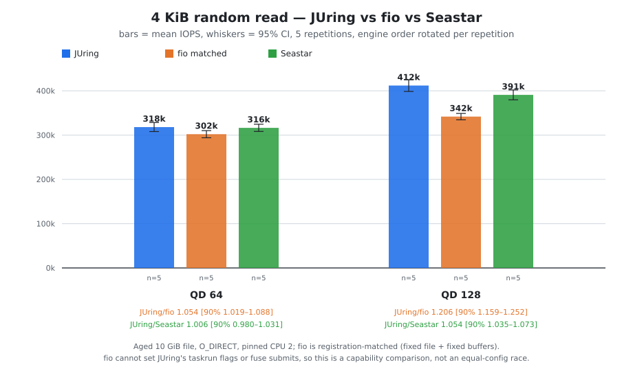
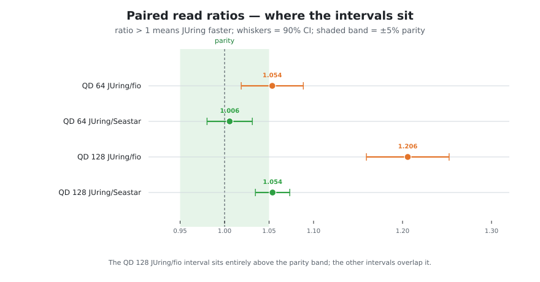
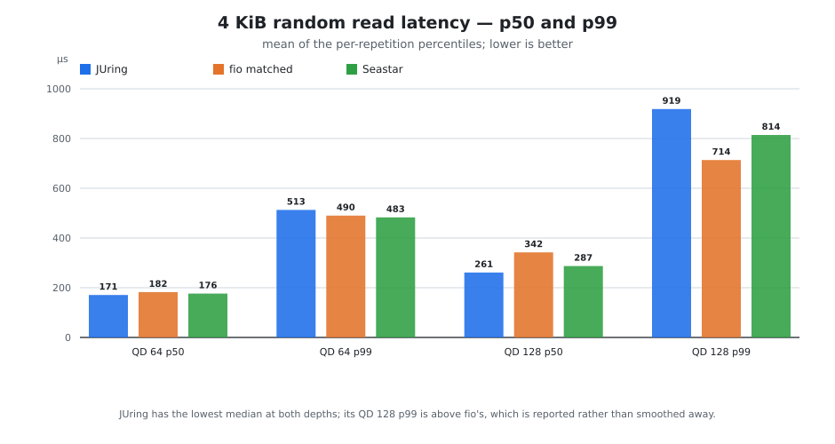
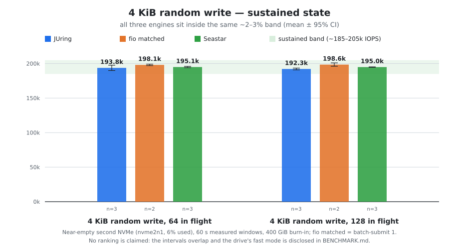
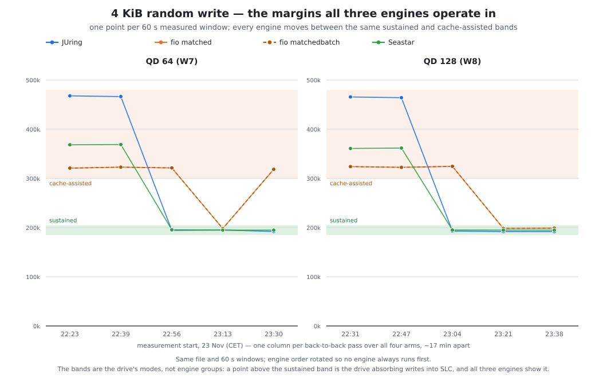

# JUring

**Asynchronous file I/O for Java, directly on Linux `io_uring`.**

[](https://github.com/davidtos/JUring/actions/workflows/ci.yml)


Java's file I/O is still synchronous. A read on a local file ends in a syscall that
keeps the thread inside the kernel until the disk answers, so keeping fast storage
busy costs you a pile of threads. Virtual threads don't fix it either: when one
blocks in a file syscall it stays mounted on its carrier, and Loom quietly grows the
carrier pool to compensate.

I built JUring to get around that. It drives Linux's `io_uring` from pure Java with
the Foreign Function & Memory API: no JNI, no C glue, no `liburing`, and no runtime
dependencies beyond the JDK.

One ring reaches about **412,000 4 KiB random reads per second** on a consumer NVMe
with 128 requests in flight. That's roughly 21% more than `fio` and 5% more than
Seastar on the same machine, and it uses about a quarter fewer CPU cycles per request at
64 requests in flight.

If you run a JVM service that spends its life waiting on `read(2)` — a database, a
write-ahead log, a search index, a data pipeline — this is for you.

## Why I built it

I was digging into virtual-thread pinning for a blog post and kept hitting the same
wall. Regular files aren't pollable, so a virtual thread blocked on `read(2)` burns
its carrier. The kernel already has an interface for this: `io_uring`. User space
and the kernel share two queues, one for submissions and one for completions, so a
single thread can keep many operations in flight and reap finished ones in batches.

The problem was reaching it from Java. Before the FFM API you had to write native
code or depend on a wrapper. So I mapped the rings into Java memory, wrote the
submission and completion paths with `VarHandle`s, and kept going until reads,
writes, cancellation, timeouts, and shutdown all behaved.

That turned into a library. It's pre-1.0, but it's not a prototype.

## What's in it

| Piece | What it does |
|---|---|
| `JUring` | The raw single-threaded ring: reads, writes, vectored I/O, open/close, `fsync`/`fdatasync`, `fallocate`, `ftruncate`, `statx`, timeouts, linked timeouts, and cancellation. |
| Registered files and fixed buffers | Kernel-side pins that remove per-operation descriptor and buffer lookups. |
| `JuringFile` | A file handle on top of a ring: offset I/O, truncate, allocate, discard, `fadvise`, durability modes, and typed errors. |
| `JuringInputStream` / `JuringOutputStream` | Buffered streams with bounded read-ahead and write-behind. Each stream allocates a fixed set of buffers when it opens and reports its footprint. |
| `GroupCommit` | Batches durability for concurrent writers, so a group shares one `fdatasync` instead of paying for one each. |
| `JUringBlocking` | Ordinary blocking calls for virtual threads. A few poller threads submit and reap while callers park without pinning a carrier. |
| `IoShard` / `RingGroup` | One ring per core, with work spread across them, affinity, backpressure, and cross-thread-safe statistics. |
| Metrics | Per-ring and per-shard counters, latency histograms, and JMX MXBeans. |

Everything lives in `com.davidvlijmincx.lio.api`, exported by the `JUring` module.

## Install

0.1.0 is the current version, but it isn't on Maven Central yet. Build it from source
for now:

```sh
git clone https://github.com/davidtos/JUring.git
cd JUring
mvn install
```

Once the release is published, the dependency will be:

```xml
<dependency>
    <groupId>io.github.davidtos</groupId>
    <artifactId>juring</artifactId>
    <version>0.1.0</version>
</dependency>
```

You need Linux on x86-64 or aarch64, JDK 25 or newer, and native access enabled
(`--enable-native-access=JUring` on the module path, `ALL-UNNAMED` on the classpath).
If you deploy in a container, call `JUring.isSupported()` before creating a ring:
Docker's default seccomp profile, AppArmor, and `kernel.io_uring_disabled` can all
block io_uring. [docs/platforms.md](docs/platforms.md) has the details and the
`java.nio` fallback. The test suite needs io_uring enabled and the native-access flag;
CI and the platform doc show the setup.

The API is pre-1.0 but covered by the compatibility policy in
[docs/api-stability.md](docs/api-stability.md); [CHANGELOG.md](CHANGELOG.md) lists what
changed.

## Quick start

Here's a batched read: one registered file, a pool of fixed buffers, and a single
submission. The three ring flags turn on the fast path.

```java
import com.davidvlijmincx.lio.api.*;
import java.nio.file.Path;
import static com.davidvlijmincx.lio.api.IoUringOptions.*;

public class DirectRead {
    public static void main(String[] args) {
        try (JUring ring = new JUring(128,
                IORING_SETUP_SINGLE_ISSUER,
                IORING_SETUP_COOP_TASKRUN,
                IORING_SETUP_DEFER_TASKRUN);
             FileDescriptor file = new FileDescriptor(Path.of("data.bin"), LinuxOpenOptions.READ_DIRECT)) {

            ring.registerFiles(file);
            ring.registerBuffers(4096, 64);

            for (int i = 0; i < 64; i++) {
                int buffer = ring.checkOutBuffer();
                ring.prepareReadFixed(0, 4096, (long) i * 4096, buffer);
            }

            // One io_uring_enter submits all 64 reads and reaps the completions.
            ring.submitAndWaitForBatchResult(64, 64, result -> {
                System.out.println("read " + result.result() + " bytes");
                ring.checkInBuffer(result.bufferIdx());
            });
        }
    }
}
```

And here's the same idea with a blocking API on virtual threads. Each call parks its
virtual thread while the poller thread submits the request, so the carrier is free to
run other work:

```java
import com.davidvlijmincx.lio.api.*;
import java.lang.foreign.Arena;
import java.lang.foreign.MemorySegment;
import java.nio.file.Path;
import java.util.concurrent.Executors;

public class VirtualThreadReads {
    public static void main(String[] args) throws Exception {
        try (JUringBlocking ring = new JUringBlocking(256);
             FileDescriptor file = new FileDescriptor(Path.of("data.bin"), LinuxOpenOptions.READ_DIRECT);
             var threads = Executors.newVirtualThreadPerTaskExecutor()) {

            for (int i = 0; i < 1_000; i++) {
                long offset = (long) i * 4096;
                threads.submit(() -> {
                    try (Arena arena = Arena.ofConfined()) {
                        MemorySegment buffer = arena.allocate(4096, 4096);
                        long read = ring.read(file, buffer, offset);
                        if (read != 4096) throw new IllegalStateException("short read: " + read);
                    }
                    return null;
                });
            }
        }
    }
}
```

Runnable, self-checking versions of these patterns live in
[docs/examples.md](docs/examples.md) and run as part of the test suite.

## Performance

I don't trust a benchmark number without its setup, so here it is. The two deep-queue
4 KiB random-read rows are from a 2026-11-23 rerun on the protocol the project has
used since 0.1.0: fresh process per repetition, five repetitions, 10 s warmup and
30 s measured, engines interleaved with their order rotated per repetition, on an
aged 10 GiB file opened with `O_DIRECT`. The write block below is from a second,
near-empty NVMe of the same model, on the state-controlled protocol described in
[BENCHMARK.md](BENCHMARK.md#second-drive-steady-state-run-2026-11-23): a 400 GiB
steady-state burn-in, then 60 s warmup + 60 s measured continuous passes. The
1 MiB sequential, stream, shard and group-commit rows are the 0.1.0 measurements
and were not re-run. The host is an AMD Ryzen 9 3950X with a 1 TB PCIe 4.0 NVMe,
Fedora 44, kernel 7.0.12, OpenJDK 26.

The comparison points are `fio` (its io_uring engine, configured with the same
registered files and fixed buffers) and Seastar, a mature C++ storage framework. Its
io_uring reactor is the closest C++ comparison I could build.

| Workload | JUring | fio matched (io_uring) | Seastar | Result |
|---|---|---|---|---|
| 4 KiB random read, 64 in flight | 318k IOPS | 302k IOPS | 316k IOPS | 5.4% ahead of fio (90% CI 1.9–8.9%), level with Seastar |
| 4 KiB random read, 128 in flight | 412k IOPS | 342k IOPS | 391k IOPS | 20.6% ahead of fio (90% CI 15.9–25.2%), 5.4% ahead of Seastar (3.5–7.3%) |
| 1 MiB sequential read, 32 in flight | 4,720 MiB/s | 4,647 MiB/s | 4,632 MiB/s | all within 2%; the drive is the limit |
| 128 KiB stream read | 2,285 MiB/s | — | 2,328 MiB/s | within 2% of Seastar's stream API |
| 8 rings, 4 KiB random read | 473k IOPS | 459k IOPS | 466k IOPS | 1.48× its own one-shard baseline (321k), within ~3% of both |
| Durable 4 KiB writes, batches of 128 | 721 MiB/s | — | — | one `fdatasync` per batch, verified |

The first two rows are the interesting ones, and the honest reading is narrower
than the raw IOPS gap suggests. At 64 requests in flight, JUring is about 5% ahead
of `fio` and level with Seastar: the 90% CI of the JUring/fio ratio is
`[1.019, 1.089]` and JUring/Seastar is `[0.980, 1.031]`. At 128 it pulls further
ahead: about 21% over `fio` (`[1.159, 1.252]`) and about 5% over Seastar
(`[1.035, 1.073]`). The gap isn't magic. `fio` can't set JUring's ring flags or
fuse submissions, so this is a capability comparison, not an equal-config race;
Seastar's io_uring reactor has no taskrun flags and no registration, so it is a
bracket as well.



*The two 4 KiB read rows from the 2026-11-23 rerun: mean IOPS with 95% CIs, five
repetitions each, engine order rotated. JUring leads fio at both depths and is level
with Seastar at QD 64.*



*The paired ratios are the sharper view: at QD 128 JUring/fio sits entirely above the
±5% parity band, while the QD 64 intervals and both Seastar intervals overlap it.*

At 64 in flight, `perf` puts JUring at **11.3k CPU cycles per operation** against
15.2k for `fio`, with **0.33 syscalls per operation** against 1.01. That's consistent with one `io_uring_enter` doing a batch instead of one
enter per request.

Queue depth 1 is the honest check. One request is one round trip for everyone, and
all three engines land around 11k IOPS. Async I/O buys queue depth. It does not make
a single request faster.

Tail latency from the same rerun, at 64 in flight: p99 is 513 µs for JUring, 490 µs
for `fio`, and 483 µs for Seastar; at 128 in flight they are 919, 714 and 814 µs.
JUring has the lowest median at both depths, but its QD 128 p99 is about 29% above
`fio`'s, and that is reported rather than smoothed away. The dedicated 120 s
tail-latency run behind the p999 numbers was not repeated, so its p99 values in
BENCHMARK.md differ from these.



*Mean of the per-repetition percentiles from the same rerun. JUring has the lowest
median at both queue depths; its QD 128 p99 is higher than fio's.*

### Write throughput

The short version: in the drive's sustained state all three engines perform the same
within a few percent; it is the hardware's write-mode switching that makes a finer
ranking difficult. I ran the comparison on a second, near-empty NVMe of the same
model (`nvme2n1`, 6% used) on 2026-11-23, because the main drive's 81% fill made its
write state unusable. After a 400 GiB steady-state burn-in, five state-controlled passes
ran: one pass is the four arms across both queue depths run back-to-back (60 s warmup +
60 s measured each), with the engine order rotated between passes.

The drive has two write modes — sustained storage and a cache-assisted SLC-burst mode —
and they belong to the drive, not to the engines. In its sustained mode all three land
within about 3%:

| 4 KiB random write | JUring | fio matched (io_uring) | Seastar |
|---|---|---|---|
| QD 64, sustained | 193.8k ± 3.9k IOPS (n=3) | 198.2k IOPS (n=1) | 195.1k ± 1.0k IOPS (n=3) |
| QD 128, sustained | 192.3k ± 1.3k IOPS (n=3) | 198.6k ± 2.4k IOPS (n=2) | 195.0k ± 0.4k IOPS (n=3) |



*Sustained-state means with 95% confidence intervals on the near-empty second NVMe.
The shaded band is the drive's sustained ceiling; all three engines sit inside it.*

The drive also has a cache-assisted mode: it intermittently absorbs writes into its
SLC cache, lifting any engine above the sustained ceiling. That mode is the drive's,
not the engine's. A controlled probe on this drive — the same `fio` command,
`--iodepth_batch_submit` from 1 to 128, run twice — flipped between ~220k and ~320k
with no dependence on batch size or fixed buffers, so the fast windows cannot be read
as a configuration result. They are excluded from the sustained comparison and not
used for ranking; every run is listed in BENCHMARK.md.



*Columns are the five consecutive passes, labelled by start time (CET); each point is one
60 s measured window (QD 64 left, QD 128 right). Every engine moves between the same two
bands; both bands are the drive's, so the fast windows are not used for ranking.*

The frozen homogeneity gate (four valid passes required) therefore returns no verdict:
0 of the 5 passes passed it. **No write ranking is claimed**; the defensible statement
is that all three engines reach the same ~192–199k IOPS sustained ceiling on this
drive, and that the higher windows are cache-assisted on all three. Full per-run data,
the probe and the mode analysis are in
[BENCHMARK.md](BENCHMARK.md#second-drive-steady-state-run-2026-11-23).

### Virtual threads

The interesting part of `JUringBlocking` is what it does to thread counts. Callers
write ordinary blocking calls, while a small number of platform poller threads submit
requests and unpark the virtual threads when completions arrive.

With Loom's default carrier pool, `FileChannel` already reaches the device: in a
250-virtual-thread run, `FileChannel` did about 445k operations per second and
`JUringBlocking` 441k. With a four-platform-thread budget the gap opens. In the
historical JMH run, `FileChannel` managed about 43k ops/s from four carriers, while
`JUringBlocking` reached about 452k ops/s from two carriers and two pollers.

That run predates 0.1.0 and the harness didn't record its JVM flags, so treat those
numbers as thread-efficiency evidence rather than a stable ranking. The defensible
claim is that JUring keeps the device equally busy with a handful of poller threads
instead of hundreds of carriers, which matters in a container with a CPU quota.

### What the numbers don't say

The two 4 KiB random-read rows are from a 2026-11-23 rerun: fresh process per
repetition, five repetitions, 10 s warmup + 30 s measured, engine order rotated per
repetition, the same registration-matched `fio` reference. They reproduce the 0.1.0
run within about 2%.

Two things you should know before quoting these numbers. First, `fio` can't set
JUring's ring flags (`SINGLE_ISSUER`, `COOP_TASKRUN`, `DEFER_TASKRUN`) or fuse
submissions, so the read comparison is a capability comparison, not an equal-config
race. Second, this is one host and one consumer NVMe. Absolute IOPS depend on drive
state, so treat the numbers as evidence, not a specification.

The write path is still not ranked, and the second-drive run shows why. The main
drive was 81% full and could not keep its write state stable for a whole pass. On
the near-empty same-model drive, all three engines settle at ~192–199k IOPS, and
all three also show cache-assisted windows. A controlled probe ran the same `fio`
command with `--iodepth_batch_submit` from 1 to 128 and flipped between ~220k and
~320k independently of batch size, so those fast windows are the drive's
write-cache/GC mode, not a `fio` configuration advantage. The frozen
homogeneity gate returns no verdict (0 of the 5 passes) for the same reason. Every
run, including the cache-assisted windows, is listed.

Full tables, raw methodology, and reproduction commands are in
[BENCHMARK.md](BENCHMARK.md) and [docs/benchmark-methodology.md](docs/benchmark-methodology.md).

## How it works

- **The ring is shared memory with the kernel.** `io_uring_setup` reports offsets
  into a mapping. JUring maps it with `mmap` and touches submission and completion
  entries through `VarHandle` accesses. The kernel reads and writes the same cache
  lines, so publishing the submission tail and consuming the completion head need
  the right fences; a jcstress profile exists to keep that ordering honest.
- **One syscall per batch.** Requests are prepared into the submission queue, then a
  single `io_uring_enter` submits the batch and reaps completions. The fast path uses
  `SINGLE_ISSUER | COOP_TASKRUN | DEFER_TASKRUN`, which keeps the kernel from waking
  task work on every completion.
- **Registered files and fixed buffers.** Descriptors and buffers are pinned in the
  kernel once and referenced by index per operation, removing per-request lookups.
- **No allocation on the raw-ring hot path.** Ring entries, completion records, and
  buffer indexes are pre-allocated and reused after setup; passing explicit
  `SqeOptions` allocates its varargs array at the call site. `JUringBlocking`
  pre-allocates one call record per concurrent call.
- **Virtual threads park, carriers stay free.** `JUringBlocking` parks callers while
  their request is in flight and never creates extra platform threads.

## How I test it

The correctness story matters more than the throughput story, because a fast I/O
library that corrupts one completion is worse than a slow one. The suite has 478
tests across 66 test classes: conformance against `java.nio`, lifecycle and
use-after-close, cancellation, timeouts, registered-buffer lifetimes, bounded stream
memory, zero allocation, and per-handle completion routing. A separate jcstress
profile exercises the memory model of the handoff between poller threads and parked
virtual threads. CI builds and runs the suite on JDK 25 and 26, checks Javadoc with
doclint, and verifies the release artifacts.

The benchmark side is built the same way. A harness under `bench/` drives `fio`,
Seastar, and JUring through the same workloads, records raw JSON per repetition, and
analyzes paired ratios with confidence intervals. The results are public, negative results
included.

## Documentation

- [BENCHMARK.md](BENCHMARK.md) — full results, methodology, and reproduction.
- [docs/benchmark-methodology.md](docs/benchmark-methodology.md) — the measurement protocol, host checks, and statistics.
- [docs/design-notes.md](docs/design-notes.md) — the decisions behind the design, including what I rejected.
- [docs/examples.md](docs/examples.md) — runnable examples mapped to real patterns.
- [docs/platforms.md](docs/platforms.md) — kernels, architectures, containers, and fallbacks.
- [docs/vt-scale.md](docs/vt-scale.md) — sizing `JUringBlocking` for a large virtual-thread fan-out.
- [docs/api-stability.md](docs/api-stability.md) — what the pre-1.0 API promises.
- [docs/qos-decision.md](docs/qos-decision.md) — why QoS is out of scope.
- [CHANGELOG.md](CHANGELOG.md), [UPGRADING.md](docs/UPGRADING.md), [CONTRIBUTING.md](CONTRIBUTING.md),
  and [DATA-AVAILABILITY.md](DATA-AVAILABILITY.md).

## What it doesn't do

I left QoS and fair queuing out on purpose ([the reasoning is here](docs/qos-decision.md)). That's reactor-layer work, not an
`io_uring` capability, and building it here would turn the library into a worse
Seastar. If you need priorities, partition work across separate rings or shards, or
use cgroup v2 `io.weight` and `ionice`. The `IoPriority` hint is passed through to the
block layer, where it's only as good as the configured scheduler.

JUring is Linux-only and file-I/O-only. No network I/O, no Windows, no macOS,
`java.nio` is the fallback there. 0.1.0 is the first release, and it isn't on Maven
Central yet; see
[docs/api-stability.md](docs/api-stability.md) for what that means.

## About me

I'm David Vlijmincx, an Oracle ACE who writes about Java performance and concurrency at
[davidvlijmincx.com](https://davidvlijmincx.com). I speak at conferences and build JVM
systems projects in the open. JUring started as a way to understand `io_uring` from
the inside, and turned into a library I reach for whenever I need Java to keep
storage busy without hundreds of platform threads.

If your team builds storage infrastructure or works close to the JVM and you're
hiring, I'd be glad to talk. Reach me on
[LinkedIn](https://www.linkedin.com/in/david-vlijmincx/) or
[@davidtos](https://github.com/davidtos) on GitHub.

## License

Apache License 2.0. See [LICENSE](LICENSE) and [NOTICE](NOTICE).
