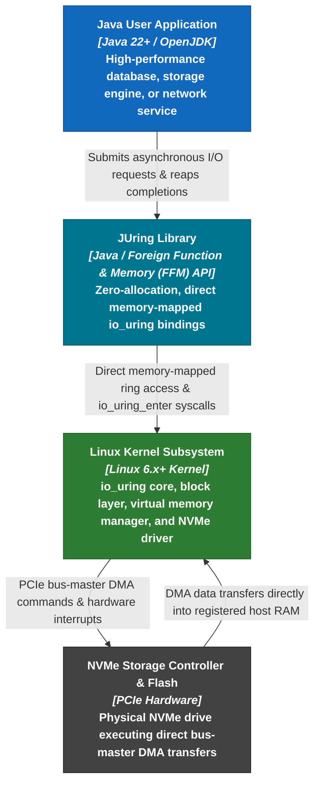
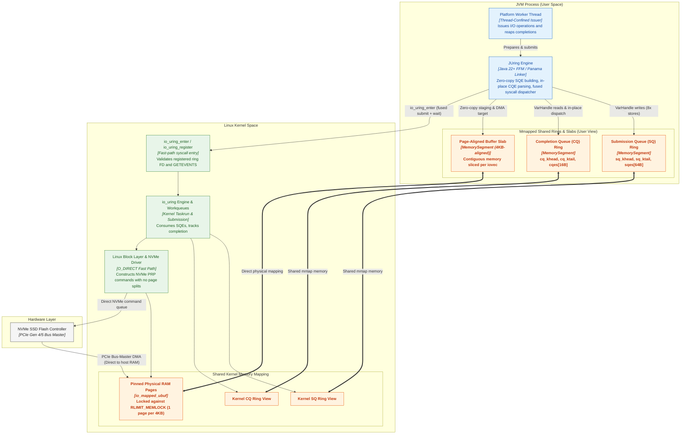
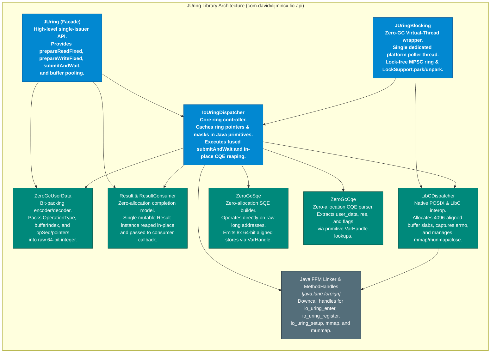

# C4 Architecture Model for JUring

This document provides a comprehensive C4 architecture model (Context, Container, Component, and Code) for `JUring`.

---

## 1. Level 1: System Context Diagram

The System Context diagram illustrates how a Java application interacts with `JUring`, the Linux operating system, and the physical NVMe storage hardware.



---

## 2. Level 2: Container / Runtime Architecture Diagram

The Container diagram details the runtime boundary between the JVM user-space process and the Linux kernel, highlighting the shared memory-mapped rings, registered page-aligned memory slabs, and hardware interactions.



---

## 3. Level 3: Component Diagram

The Component diagram details the internal software modules inside `JUring` and how they interact with Java's Foreign Function & Memory (FFM) API.



---

## 4. Level 4: Code & Data Structures (Memory Layout)

The Code-level diagram shows the physical memory layout of data structures mapped between Java and the Linux kernel.

### A. 64-Byte Submission Queue Entry (`io_uring_sqe`) Layout
```
+---------------+---------------+---------------+---------------+
|  opcode (1B)  |   flags (1B)  |          ioprio (2B)          |  Offset 0..3
+---------------+---------------+---------------+---------------+
|                             fd (4B)                           |  Offset 4..7
+---------------------------------------------------------------+
|                            off (8B)                           |  Offset 8..15
+---------------------------------------------------------------+
|                           addr (8B)                           |  Offset 16..23
+-------------------------------+-------------------------------+
|            len (4B)           |          rw_flags (4B)        |  Offset 24..31
+-------------------------------+-------------------------------+
|                          user_data (8B)                       |  Offset 32..39
+---------------+---------------+-------------------------------+
| buf_index (2B)|  personality  |        file_index (4B)        |  Offset 40..47
+---------------+---------------+-------------------------------+
|                           addr3 (8B)                          |  Offset 48..55
+---------------------------------------------------------------+
|                            pad (8B)                           |  Offset 56..63
+---------------------------------------------------------------+
```

### B. 16-Byte Completion Queue Entry (`io_uring_cqe`) Layout
```
+---------------------------------------------------------------+
|                          user_data (8B)                       |  Offset 0..7
+-------------------------------+-------------------------------+
|            res (4B)           |           flags (4B)          |  Offset 8..15
+-------------------------------+-------------------------------+
```
* **Why it matters:** In-place reaping loops read `user_data`, `res`, and `flags` directly from this 16-byte memory-mapped ring slot via `ZeroGcCqe` VarHandles bound to primitive `long`/`int` without allocating any intermediate `MemorySegment` objects on the Java heap.

### C. 64-Bit Bitpacked `user_data` Layouts

**1. Fixed-Buffer Operations (`READ_FIXED`, `WRITE_FIXED`):**
```
 63           56 55           40 39                            0
+---------------+---------------+-------------------------------+
| OpType (8 bits| BufIdx (16 bit|      Operation ID (40 bits)   |
|   0..255      |   0..65535    |       Monotonic opSeq         |
+---------------+---------------+-------------------------------+
```

**2. General Pointer Operations (`READ`, `WRITE`, `OPEN`, `CONNECT`, `RECV`, `SEND`):**
```
 63           56 55                                            0
+---------------+-----------------------------------------------+
| OpType (8 bits|            Native Payload Pointer (56 bits)   |
|   0..255      |           Raw off-heap memory address         |
+---------------+-----------------------------------------------+
```

**3. External Write Operations (`TYPE_WRITE_EXT = 20`):**
```
 63           56 55                                            0
+---------------+-----------------------------------------------+
| Type 20 (8 bit|              Operation ID (56 bits)           |
+---------------+-----------------------------------------------+
```
* **Why it matters:** Eliminates hash maps, off-heap state descriptors, and memory allocation during completion reaping. When a completion arrives, `(userData >>> 56) & 0xFF` extracts the operation type in a single CPU cycle, compiling directly into a fast C2 JIT `tableswitch`.

### D. Contiguous Page-Aligned Buffer Slab
```
+-----------------------------------+-----------------------------------+
|     4096-Byte Buffer [0]          |     4096-Byte Buffer [1]          |
|  Page N (Aligned to 4096 bytes)   |  Page N+1 (Aligned to 4096 bytes) |
|  Single NVMe PRP Entry (No Split) |  Single NVMe PRP Entry (No Split) |
+-----------------------------------+-----------------------------------+
```
* **Why it matters:** Slicing from an aligned slab guarantees that every 4 KB buffer is bounded within exactly one physical page, preventing double-counting against `RLIMIT_MEMLOCK` and eliminating NVMe DMA split overhead.
