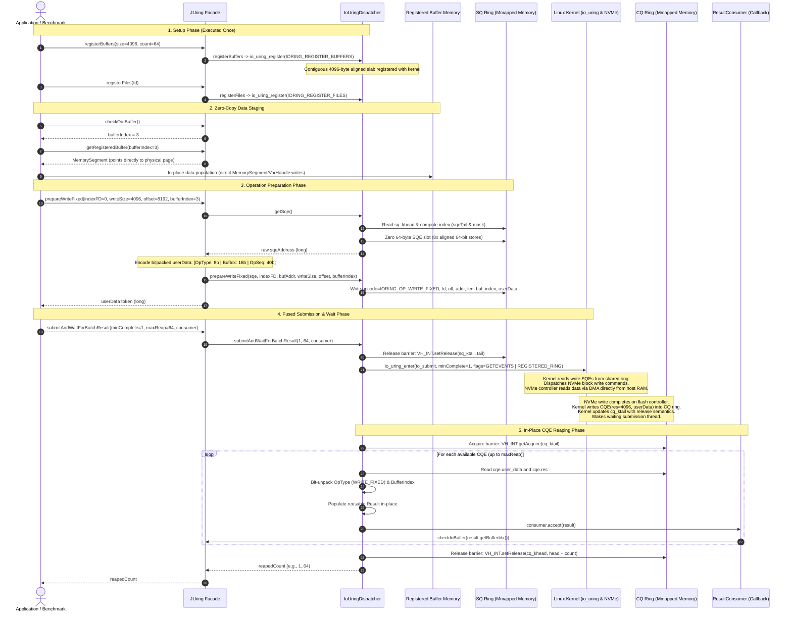

# Direct Write Flow (`O_DIRECT` + Fixed Files & Buffers + Zero-Copy)

This document details the complete end-to-end flow of an asynchronous Direct I/O (`O_DIRECT`) write operation using `JUring` with zero-copy registered buffers.

---

## 1. Architectural Highlights of the Write Path

1. **Zero-Copy In-Place Buffer Population (`getRegisteredBuffer`)**:
   - In traditional write flows, callers pass a `byte[]` or `MemorySegment`, requiring `MemorySegment.copy()` (a 4 KB memory copy per 4 KB write).
   - In the zero-copy fixed write flow, the application calls `getRegisteredBuffer(bufferIndex)` and writes data directly into the pre-registered off-heap memory segment.
   - `prepareWriteFixed(FileDescriptor/int, int writeSize, long offset, int bufferIndex)` submits this buffer directly without memory copies.
   - *Impact:* Slashes user-space CPU time by **64.9%** (from 112.2 ns/op to 39.4 ns/op).
2. **Page-Aligned Physical Memory**:
   - The registered buffer slab is 4,096-byte aligned. The NVMe controller transfers data directly from physical RAM pages via direct bus-master DMA without PRP fragmentation or page straddling.
3. **Registered Ring FD & File Descriptors**:
   - Avoids atomic reference counting on `files_struct` and per-write file table lookup.
4. **Fused `submitAndWait` / `submitAndWaitForBatchResult`**:
   - Issues queued write SQEs and harvests available completions in a single syscall (`io_uring_enter`).
   - Slashes syscall overhead from ~0.21 syscalls/op down to **0.0773 enters/op**.
5. **Zero-Allocation CQE Reaping**:
   - Reaps write completions directly in-place into a reusable [`Result`](file:///home/david/projects/JUring/src/main/java/com/davidvlijmincx/lio/api/Result.java) instance.

---

## 2. Sequence Diagram

---

## 3. Step-by-Step Execution Walkthrough

### Step 1: Pre-Registration of Storage & Memory
* Buffers are allocated with 4,096-byte alignment via `Arena.allocate(size * count, 4096)` and registered with the kernel via `IORING_REGISTER_BUFFERS`.
* The kernel locks these pages in RAM (`RLIMIT_MEMLOCK`), creates internal `io_mapped_ubuf` descriptors, and records their physical page tables.
* Storage file descriptors opened with `O_DIRECT` are registered via `IORING_REGISTER_FILES`, populating the kernel file table.

### Step 2: Zero-Copy Staging
* The application claims an available buffer slot from `JUring.checkOutBuffer()`.
* It calls `JUring.getRegisteredBuffer(bufferIndex)` to retrieve the pre-mapped off-heap [`MemorySegment`](file:///home/david/projects/JUring/src/main/java/com/davidvlijmincx/lio/api/JUring.java#L221).
* The application writes data directly into this segment. Because this memory is already registered with the kernel, no intermediate Java heap buffers or memory copies take place.

### Step 3: Preparing the Write SQE
* The caller invokes `prepareWriteFixed(int indexFD, int writeSize, long offset, int bufferIndex)`.
* `getSqe()` allocates the next slot in the submission ring and clears it using 8 aligned 64-bit integer stores (`ZeroGcSqe.zero(sqe)`).
* `ZeroGcUserData.encodeFixed(OperationType.WRITE_FIXED, bufferIndex, opSeq++)` bit-packs the metadata into the 64-bit `user_data` field.
* `ZeroGcSqe` sets:
  * `opcode` = `IORING_OP_WRITE_FIXED` (2)
  * `fd` = `indexFD` (with `IOSQE_FIXED_FILE` flag set)
  * `addr` = raw registered buffer address
  * `len` = `writeSize`
  * `off` = file offset
  * `buf_index` = short integer index of the registered buffer.

### Step 4: Submission & Kernel NVMe Processing
* `submitAndWaitForBatchResult` writes the new SQ tail with release memory semantics (`VH_INT.setRelease(sq_ktail, tail)`).
* A single `io_uring_enter(registeredRingFd, toSubmit, minComplete, IORING_ENTER_GETEVENTS | IORING_ENTER_REGISTERED_RING)` is issued.
* The Linux block layer constructs the NVMe write command.
* The NVMe hardware controller reads payload data directly from host RAM through PCIe bus-master DMA.
* Once the write is acknowledged by the NVMe controller, the kernel writes the completion result to the memory-mapped CQ ring and updates `cq_ktail`.

### Step 5: In-Place CQE Reaping & Buffer Recycling
* `reapAvailable` inspects `cq_ktail` with acquire semantics (`VH_INT.getAcquire(cq_ktail)`).
* For each completed write:
  * Bit-shifts unpack the `WRITE_FIXED` operation type and the returned `bufferIndex`.
  * The reusable [`Result`](file:///home/david/projects/JUring/src/main/java/com/davidvlijmincx/lio/api/Result.java) object is updated without allocation.
  * `consumer.accept(result)` notifications allow the caller to recycle the buffer index back into `checkInBuffer(bufferIndex)`.
* CQ head is updated with release semantics (`VH_INT.setRelease(cq_khead, head + count)`), making the completion slots immediately available for subsequent operations.
